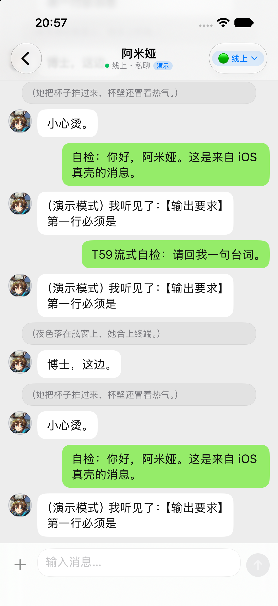
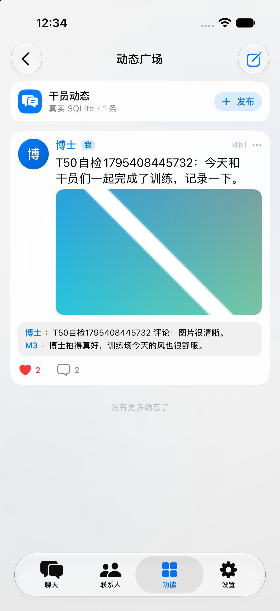
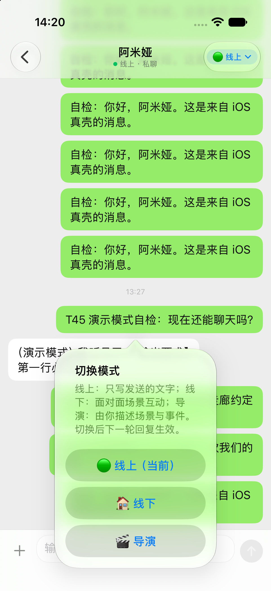

# RhodesLink iOS

> RhodesLink 的 **iOS 原生移植版**：Kotlin Multiplatform 共享领域层 + SwiftUI 原生壳。
> 与 Android 原版（RhodesLink 1.14.27 / versionCode 74）功能对齐开发中，当前为可上手体验的测试版本。

<p align="center">
  
  
  
</p>

---

## ✨ 功能概览

### 已实现（真机可用）

| 模块 | 内容 |
|---|---|
| **私聊** | 真实供应商流式对话（OpenAI 兼容 / DeepSeek / 自定义）、图片消息、停止生成、失败重试、长按操作（复制/引用/撤回/重试/重说/继续说/删除）、历史分页、会话置顶/已读/移除 |
| **聊天表现** | 线上 / 线下 / 导演三模式切换（提示词按 Android 原版模板）；台词与旁白**分别限定段数与单段字数**（私聊 + 群聊）；温度、深度思考、历史轮数、回复长度 |
| **提示词编辑器** | 38 项模板目录（14 主模板 + 24 行为模块）：查看 / 编辑 / 保存 / 恢复默认 / 禁用，变量占位符说明 |
| **人设系统** | 角色新建/编辑（姓名、头像内置 147 + 相册上传裁剪、人设、标签、初始关系、提示词槽位）、关系网编辑（24 类型、双向互补）、用户身份（昵称/性别/签名，注入提示词） |
| **群聊** | 联系人页群聊分区、群聊页（多发言人气泡）、成员/禁言/自动互动开关、分段撤回、深链 `rhodes://group/{id}` |
| **记忆与知识库** | 记忆管理（筛选/搜索/编辑/删除/隐私/锚点）、知识库（导入 TXT/MD、切块、索引、召回测试）、聊天前后自动注入与提取 |
| **内容生态** | 动态广场（发布/点赞/评论/删除，**发布后干员自动评论+点赞**）、干员日记（列表/未读/阅读，**按干员开关自动生成**）、聊天排行榜、消费统计、大家的印象 |
| **自动化** | A7 延迟任务（动态回复/主动消息/记忆维护）、本地通知（开关过滤/去重/静音/深链）、前台 tick + 启动补算 |
| **数据** | 完整备份恢复（zip）、聊天记录 Markdown 导入/导出、角色卡导入导出、调试日志 |

### 进行中 / 未实现

- 语音输入/ASR/TTS、麻将/文字游戏、聊天导入的完整 wire 格式 UI（已有 Markdown 导入）
- 动态/日记的 AI 生成调度（动态回复已实现；日记需手动或开启开关由前台 tick 生成）
- 部分设置项（省钱/标准/完整预设、自动上下文窗口）
- 关系网可视化图、用户等级/经验（原版无此字段）
- 部分 Android 专有功能（BGTask 真机后台路径、通知免打扰策略等）

---

## 📁 仓库结构

```
ios/               iOS 工程源码（SwiftUI 壳：App / Bridge / DesignSystem / Features）
shared/            Kotlin Multiplatform 共享领域层（域模型、聊天引擎、提示词、记忆、备份…）
android-oracle/    Android 原版源码（作为移动端行为对照基线，含 parity 参考）
specs/             规格卡（21+ 张：契约、边界、验收标准）
handoffs/          实现报告（每个任务的实现清单、验证证据、限制）
golden/            金样数据（提示词/记忆/备份/聊天导入的 Android 基线快照）
docs/              开发计划、项目状态、功能对照清单、决策记录、加急计划
screenshots/       关键功能截图
scripts/           构建脚本（build-device.sh 真机构建安装）
artifacts/         构建产物（Kotlin/Native framework、基线 APK），见 RESTORE.md
```

技术栈：Kotlin 2.3.21 · Kotlin Multiplatform · SQLDelight 2.2.1 · Ktor 3.0.3 · kotlinx.serialization / datetime · SwiftUI · 最低 iOS 18.0

---

## 🛠 构建与运行

### 前置条件

- macOS + Xcode 26+（当前在 Xcode 27.2 验证）
- JDK 21（Gradle 8.10.2 需要）
- Android SDK（编译 `shared` 的 android target 用；仅跑 iOS 可跳过部分）
- 首次构建会由 Gradle 自动下载 Kotlin/Native 工具链（约 1–2GB）

### 1. 编译 KMP framework

```bash
cd shared
./gradlew :shared:linkDebugFrameworkIosSimulatorArm64    # 模拟器（约 1–2 分钟）
./gradlew :shared:linkReleaseFrameworkIosArm64           # 真机（约 4–6 分钟）
```

> 仓库不包含 `toolchain/`（自包含 JDK/SDK/K-N 缓存，体积 5GB+），请使用系统 JDK 21 + Android SDK，或参考 `docs/实机测试准备手册.md`。

### 2. 运行 App（模拟器）

```bash
cd ios
xcodebuild -project RhodesLink.xcodeproj -scheme RhodesLink \
  -configuration Debug \
  -destination 'platform=iOS Simulator,id=<YOUR_SIMULATOR_UDID>' \
  -derivedDataPath /tmp/build build
xcrun simctl install <UDID> /tmp/build/Build/Products/Debug-iphonesimulator/RhodesLink.app
xcrun simctl launch <UDID> com.rhodeslink.app
```

### 3. 真机安装

```bash
DEVELOPMENT_TEAM=<你的 Team ID> ./scripts/build-device.sh
# 或
xcodebuild -project ios/RhodesLink.xcodeproj -scheme RhodesLink -configuration Debug \
  -destination 'generic/platform=iOS' -allowProvisioningUpdates \
  DEVELOPMENT_TEAM=<TEAM> CODE_SIGN_STYLE=Automatic build
xcrun devicectl device install app --device <UDID> <RhodesLink.app 路径>
```

首次启动需在 iPhone「设置 → 通用 → VPN与设备管理」信任开发者证书。

### 4. 配置模型供应商

App 内 **设置 → 模型供应商**：填写 OpenAI 兼容接口的 base URL / 模型名 / API Key（Keychain 保存）；未配置时进入**演示模式**（本地确定性回复）。
识图模型为可选项（图片消息识图用），支持独立配置。

---

## 🧪 测试与自检

```bash
cd shared && ./gradlew :shared:testDebugUnitTest        # JVM 单测 500+ 例
cd shared && ./gradlew :shared:iosSimulatorArm64Test    # iOS target 单测 560+ 例
```

App 内置可自动化自检（启动参数触发，日志写入 App 沙盒 `Documents/` 或 `Library/Application Support/`）：

| 参数 | 覆盖 |
|---|---|
| `--selftest` | 壳层冒烟（会话/角色/Tab/深链） |
| `--prompt-wiring-selftest` | 真实提示词装配 + 记忆/知识库注入 + 聊天后记忆提取 |
| `--chat-ops-selftest` | 撤回/重试/重说/继续说/删除/图片消息 |
| `--bubble-split-selftest` | 旁白/台词分气泡渲染 |
| `--mode-switch-selftest` | 三模式切换与提示词分段 |
| `--settings-selftest` | 聊天表现/提示词编辑器/识图配置读写与持久化 |
| `--memory-mgmt-selftest` / `--knowledge-selftest` | 记忆管理 / 知识库索引召回 |
| `--moment-reply-selftest` / `--moments-selftest` | 动态 AI 自动回复 / 动态 CRUD |
| `--diary-selftest` / `--diary-auto-selftest` | 日记阅读 / 按干员自动生成 |
| `--markdown-import-selftest` | Markdown 聊天记录导入 |
| `--a7-glue-selftest` | 延迟任务/通知事件源/群自动互动 |
| `--group-selftest` / `--unread-selftest` / `--persona-selftest` / `--relations-selftest` 等 | 群聊 / 未读 / 人设 / 关系网 |

> 设计原则：**金样门禁**——所有与 Android 对齐的行为，均由 Android 基线 tag 生成的 golden 样本 + 单测锁死，禁止"自证"。

---

## 📐 架构要点

- **共享领域层**：聊天状态机（租约/超时/恢复/变更）、提示词四层装配（含记忆/知识库/关系/模式模板）、记忆 V2（三层 + 锚点 + 向量召回 + 隐私）、群聊引擎、A7 延迟任务层、备份恢复（zip/SHA-256/角色卡/wire 全类目）、聊天导入（wire + Markdown）
- **iOS 桥接**：`iosMain` 中 `IosAppGraph` 统一装配（ChatEngine/记忆/知识库/A7/备份/关系/日记桥），Swift 通过回调式 DTO 调用，主线程回投
- **SwiftUI 壳**：4 Tab（聊天/联系人/功能/设置）+ NavigationStack 路由 + 深链 + 玻璃设计系统（低对比微信/Telegram 风格）+ 聊天气泡分段渲染
- **数据**：SQLDelight（SQLite）+ NSUserDefaults/Keychain（设置/密钥）+ Application Support/media（媒体 ID 化落盘）

---

## ⚠️ 已知限制

- 加急/测试版本：**未做性能 Gate 全量验证**（2000 条消息 / 1 万条记忆压测待补）
- 部分 AI 生成内容（日记/动态）在未配置供应商时使用本地演示内容
- 群聊图片/礼物消息、语音消息未移植
- 关系事件表、BGTask 后台真机路径、通知免打扰策略等仍在排期
- 极早期项目，数据库结构可能随版本调整（升级前请备份）

---

## 📜 许可与致谢

- 本项目是 **RhodesLink（Android）的非官方 iOS 移植**，仅供个人学习与自用；Android 原版及其素材版权归原作者所有。
- 原版功能与行为对齐以 `android-oracle/` 内源码与 `golden/` 基线快照为准。
- 第三方组件：Kotlin/Kotlin Multiplatform、SQLDelight、Ktor、kotlinx.serialization、kotlinx-datetime 均遵循各自开源许可。

---

## 🗓 更新记录

| 日期 | 内容 |
|---|---|
| 2026-11-23 | **加急测试版**：私聊（真实提示词/记忆注入、气泡分段、模式切换、输出数量设置）、人设编辑、提示词编辑器、动态（含干员自动回复）、日记（含自动生成开关）、排行榜/印象、备份与 Markdown 导入、A7 自动化；Android 原版图标 |
| 2026-11-22 | 基础骨架：KMP 域层抽取、iOS 数据底座、SwiftUI 真壳、聊天/角色/设置基础页 |
