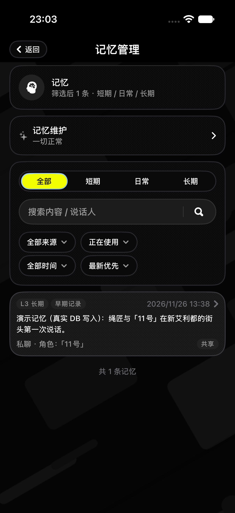
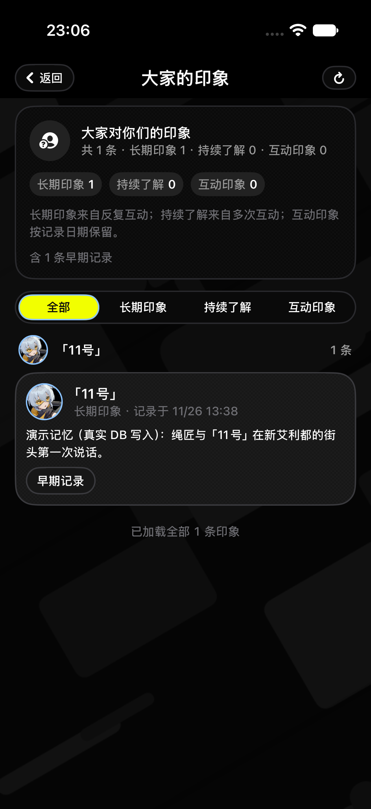
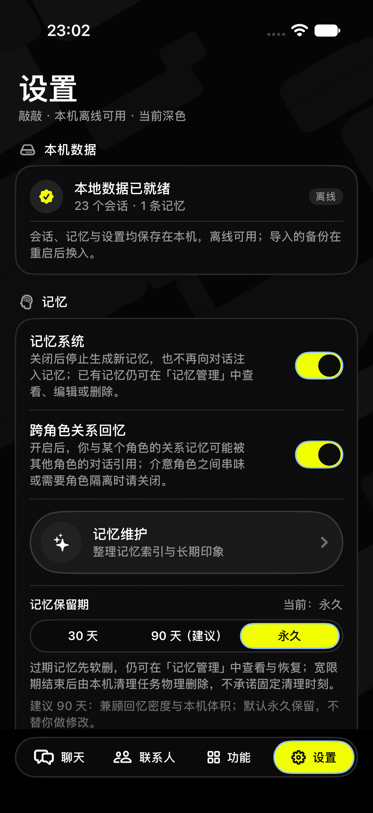
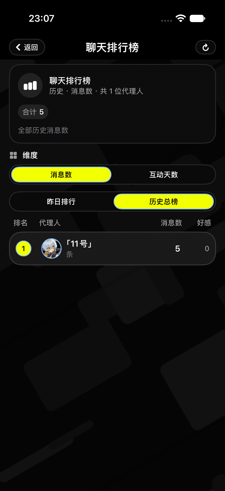

# 敲敲 KnockKnock iOS

> **KnockKnock_ios** —— 敲敲的 iOS 原生版：Kotlin Multiplatform 共享领域层 + SwiftUI 原生壳。
> 当前 **v0.3.0（build 3）测试版**：记忆与印象系统升级完成，模拟器验证通过；实机安装与发布 Gate 待执行。
> 本仓库是 RhodesLink（Android）的非官方 iOS 移植，产品名与标识以「敲敲 / KnockKnock」为准。

<p align="center">
  
  
  
  
</p>

---

## 🆕 v0.3.0 记忆与印象系统升级

| 方向 | 本版内容 |
|---|---|
| **记忆正确性** | 回复后维护、过期宽限清理、索引缺失/漂移修复、恢复备份后重建、诊断日志 |
| **检索** | BM25 词法索引 + 向量双通道、查询意图、校准准入与拒答、RRF 融合、同主题上限、父子去重、相反极性只注入较新一条、实体通道（私聊） |
| **事实与冲突** | 结构化事实键（`fact:极性:主体|谓词|客体`）、事实表、关系表（supports/contradicts）、冲突标记 `suspected`、确认后关闭旧事实有效期；整合幂等/退避/dead-letter/日预算 |
| **印象** | `impressions` 一等表（层级/置信/证据数）、证据链（≤8 条）、历史回填、按角色分组/层级筛选/分页、证据摘要跳会话、拒绝/冻结/撤销/编辑（写历史） |
| **设置与体检** | 记忆总开关、跨角色回忆开关、记忆维护（索引状态/修复）、保留期 30/90/永久 |
| **数据与迁移** | schema **33**、41 张应用表；备份 v2 纳入事实/关系/印象/证据；模拟器 0.2.0→0.3.0 覆盖安装验证通过 |
| **界面清理** | 移除调试日志入口、Token 消费面板、ID/库表名/旧版标签等技术信息；体检折叠为「记忆维护」 |

> 详细验证：[0.3.0 测试说明](docs/记忆与印象-0.3.0-实机测试说明.md)、[总体进度报告](docs/记忆与印象-总体进度报告.md)、[验收卡](specs/memory-acceptance-cards.md)。

---

## ✨ 功能概览

### 已实现（模拟器验证）

| 模块 | 内容 |
|---|---|
| **私聊** | 真实供应商流式对话（OpenAI 兼容 / DeepSeek / 自定义）、图片消息、停止生成、失败重试、长按操作（复制/引用/撤回/重试/重说/继续说/删除）、历史分页、会话置顶/已读/移除 |
| **聊天表现** | 线上 / 线下 / 导演三模式切换（提示词按 Android 原版模板）；台词与旁白**分别限定段数与单段字数**（私聊 + 群聊）；温度、深度思考、历史轮数、回复长度 |
| **提示词编辑器** | 38 项模板目录（14 主模板 + 24 行为模块）：查看 / 编辑 / 保存 / 恢复默认 / 禁用，变量占位符说明 |
| **人设系统** | 角色新建/编辑（姓名、头像内置 147 + 相册上传裁剪、人设、标签、初始关系、提示词槽位）、关系网编辑（24 类型、双向互补）、用户身份（昵称/性别/签名，注入提示词） |
| **群聊** | 联系人页群聊分区、群聊页（多发言人气泡）、成员/禁言/自动互动开关、分段撤回、深链 `rhodes://group/{id}` |
| **记忆与印象** | 三层记忆（L1/L2/L3）、BM25+向量双通道召回、拒答、实体通道、事实/关系/冲突、整合幂等与预算；印象表 + 证据链 + 回填 + 分组/分页/拒绝/冻结/编辑；记忆维护与体检 |
| **知识库** | 导入 TXT/MD、切块、索引、召回测试；聊天前后自动注入 |
| **内容生态** | 动态广场（发布/点赞/评论/删除，**发布后干员自动评论+点赞**）、干员日记（列表/未读/阅读，**按干员开关自动生成**）、聊天排行榜 |
| **自动化** | A7 延迟任务（动态回复/主动消息/记忆维护）、本地通知（开关过滤/去重/静音/深链）、前台 tick + 启动补算 |
| **数据** | 完整备份恢复（zip）、聊天记录 Markdown 导入/导出、角色卡导入导出、调试日志 |

### 进行中 / 未实现

- 语音输入/ASR/TTS、麻将/文字游戏、聊天导入的完整 wire 格式 UI（已有 Markdown 导入）
- 动态/日记的 AI 生成调度（动态回复已实现；日记需手动或开启开关由前台 tick 生成）
- 部分设置项（省钱/标准/完整预设、自动上下文窗口）
- 关系网可视化图、用户等级/经验（原版无此字段）
- 部分 Android 专有功能（BGTask 真机后台路径、通知免打扰策略等）

---

## 📁 仓库结构

```
ios/               iOS 工程（KnockKnock.xcodeproj + SwiftUI 壳：App / Bridge / DesignSystem / Features）
shared/            Kotlin Multiplatform 共享领域层（域模型、聊天引擎、提示词、记忆、备份…）
android-oracle/    Android 原版源码（作为移动端行为对照基线，含 parity 参考）
specs/             规格卡（21+ 张：契约、边界、验收标准）
handoffs/          实现报告（每个任务的实现清单、验证证据、限制）
golden/            金样数据（提示词/记忆/备份/聊天导入的 Android 基线快照）
docs/              开发计划、项目状态、功能对照清单、决策记录、加急计划
screenshots/       关键功能截图
scripts/           构建 / 截图 / 验收脚本（build-device.sh、ui-screenshot.sh、knock-yellow-audit.py）
artifacts/         构建产物（Kotlin/Native framework、基线 APK），见 RESTORE.md
```

技术栈：Kotlin 2.3.21 · Kotlin Multiplatform · SQLDelight 2.2.1 · Ktor 3.0.3 · kotlinx.serialization / datetime · SwiftUI · 最低 iOS 18.0

---

## 🛠 构建与运行

### 前置条件

- macOS + Xcode 26+（当前在 Xcode 27.2 验证）
- JDK 21（Gradle 8.10.2 需要）
- Android SDK（编译 `shared` 的 android target 用；仅跑 iOS 可跳过部分）
- 首次构建会由 Gradle 自动下载 Kotlin/Native 工具链（约 1–2GB）

### 1. 编译 KMP framework

```bash
gradle :shared:linkDebugFrameworkIosSimulatorArm64    # 模拟器（约 1–2 分钟）
gradle :shared:linkReleaseFrameworkIosArm64           # 真机（约 4–6 分钟）
```

> 仓库不包含 `toolchain/`（自包含 JDK/SDK/K-N 缓存，体积 5GB+），请使用系统 JDK 21 + Android SDK，或参考 `docs/实机测试准备手册.md`。

### 2. 运行 App（模拟器）

```bash
cd ios
xcodebuild -project KnockKnock.xcodeproj -scheme KnockKnock \
  -configuration Debug \
  -destination 'platform=iOS Simulator,id=<YOUR_SIMULATOR_UDID>' \
  -derivedDataPath /tmp/build build
xcrun simctl install <UDID> /tmp/build/Build/Products/Debug-iphonesimulator/KnockKnock.app
xcrun simctl launch <UDID> com.xsbcjx.knockknock
```

### 3. 真机安装

```bash
DEVELOPMENT_TEAM=<你的 Team ID> ./scripts/build-device.sh
# 或
xcodebuild -project ios/KnockKnock.xcodeproj -scheme KnockKnock -configuration Debug \
  -destination 'generic/platform=iOS' -allowProvisioningUpdates \
  DEVELOPMENT_TEAM=<TEAM> CODE_SIGN_STYLE=Automatic build
xcrun devicectl device install app --device <UDID> <KnockKnock.app 路径>
```

首次启动需在 iPhone「设置 → 通用 → VPN与设备管理」信任开发者证书。

### 4. 配置模型供应商

App 内 **设置 → 模型供应商**：填写 OpenAI 兼容接口的 base URL / 模型名 / API Key（Keychain 保存）；未配置时进入**演示模式**（本地确定性回复）。
识图模型为可选项（图片消息识图用），支持独立配置。

---

## 🎨 界面风格（敲敲）

> 设计依据：[`docs/敲敲UI改版计划书-v1.1.md`](docs/敲敲UI改版计划书-v1.1.md)（实测色板 / 条形栏规格 / Liquid Glass 决策树 / 验收标准）。
> 全站视觉统一为《绝区零》「敲敲」语言：**电光黄黑胶囊 + 纯色底斜切迷彩纹理 + 等宽分段栏**，深/浅双主题。

### 视觉纪律（面积配比）

| 色 | 目标占比 | 允许位置 |
|---|---|---|
| 黑 / 暖白（底 + 面板 + 行 + 描边） | ≈85% | 页面底、内容面板、胶囊行、描边层次 |
| 白 / 主文字 | ≈10% | 标题、正文、未选中图标与文字 |
| **电光黄 `#F2FF00`** | **≤5%** | 仅：选中胶囊、主按钮、角标、品牌 logo |
| **聊天蓝 `#3364E7`** | **≤3%** | 仅：发送气泡、链接、进度（聊天语义） |
| 灰阶 | ≈5% | 次文字 `#9A9A9A`、黄胶囊外圈高光 `#8CC4FF`、行底 |
| 危险红 `#BF2207` / `#FF3B30` | <1% | 关闭、删除、错误 |

> 两条铁律：**黄 = App 交互语言，蓝 = 聊天消息语言，禁止跨用**（不用黄画发送气泡、不用蓝画 Tab 选中）；**禁止毛玻璃 / 半透明白 / 渐变光斑**——页面底一律实色 + 程序化斜切迷彩纹理（浅色纹理对比度 ≤3%）。
> 黄色面积纪律由 `scripts/knock-yellow-audit.py` 在验收截图上做像素直方图抽查（阈值 5%，见下文「复现与审计」）。

### 设计 token（`ios/KnockKnock/DesignSystem/KnockTokens.swift`）

| Token | 深色 | 浅色 | 用途 |
|---|---|---|---|
| `canvas` 页面底 | `#000000` | `#F4F4F2` | 页面底 + 迷彩纹理 |
| `panel` 面板 | `#0A0A0A` | `#FFFFFF` | 内容面板 / 分组容器 |
| `row` 行底 | `#171717` | `#F7F7F5` | 胶囊行 / 输入框 |
| `stroke` 主描边 | `#2A2A2E` | `#E2E2DD` | 面板 / 行 / 胶囊容器（1.5pt） |
| `textPrimary` 主文字 | `#FFFFFF` | `#0B0B0C` | 标题 / 正文 |
| `textSecondary` 次文字 | `#9A9A9A` | `#6E6E73` | 副标题 / 说明 |
| `electric` 电光黄 | `#F2FF00` | `#F2FF00` | 选中胶囊 / 主 CTA / 品牌（≤5%） |
| `electricRing` 黄外圈 | `#8CC4FF` | `#8CC4FF` | 黄胶囊 1.5pt 高光外圈 |
| `chatBlue` 聊天蓝 | `#3364E7` | `#3364E7` | 发送气泡 / 链接（≤3%） |
| `danger` 危险 | `#BF2207` | `#BF2207` | 关闭 / 删除 / 错误底 |

- **字体**：PingFang SC 无 Heavy → `KnockTypography` 用 `.heavy` + 字号补偿 + 负 `strokeWidth` 描边加粗近似（换 MiSans Heavy 只改一处）。
- **尺寸**：顶栏 44pt · 一级分段栏/TabBar 44pt · 二级筛选栏 36pt · 搜索条 44pt · 胶囊行 64–72pt · 面板圆角 20pt · 描边 1.5pt · 按钮高 46pt · 页面边距 16pt。

### 组件库（`ios/KnockKnock/DesignSystem/`）

| 文件 | 组件 |
|---|---|
| `KnockTokens` / `KnockTypography` / `KnockTexture` | 颜色/尺寸 token、字体层级与描边补偿、程序化斜切迷彩 + 棋盘格纹理 |
| `KnockChrome` | `KnockHeader`（品牌/返回 + 居中标题 + 右侧胶囊）、`KnockTabBar`、`KnockCloseButton`、`KnockExitKey`（红色 X 结束键） |
| `KnockBars` | `KnockSearchBar`、`KnockSegmentedBar`（一级/二级分段栏）、`KnockFilterBar`、`KnockDropdown` |
| `KnockSurfaces` | `KnockPanel`、`KnockListRow`（胶囊行）、`KnockDashedButton`、`KnockGroupTitle` |
| `KnockControls` | 主/次/危险按钮、输入框、`KnockBadge`、`KnockChip`、`KnockDivider` |
| `KnockEmpty` / `KnockDialog` | `E M P T Y` 空态组合 / 自绘确认弹窗（无系统玻璃） |
| `KnockGalleryView` | 组件画廊（`--knock-gallery` 启动参数，截图验收用） |

### 形状与图标规则

- **品牌**：「敲敲」+ 黄色手绘 logo（`KnockBrandLogo`），一级页顶栏左上角。
- **底部 TabBar 与二级筛选栏同一语言**：胶囊容器（44pt / 36pt）+ **选中项 = 撑满等宽槽位的电光黄胶囊** + 1.5pt 浅蓝外圈 + 黑色 heavy 图标/文字；未选中 = 白色 heavy。
- **红色 X 结束键**：红色胶囊 `#C02207` + 内圈暗红 `#7A1404` 1.2pt 收边 + 黑色粗圆头 X（**无旋转、无贴纸尖角**）；浅色模式补 1pt 中性描边防糊底，命中区 ≥44pt。
- **空态**：面板 + `NoData` 行 + `E M P T Y` 宽字距 pill + 说明 + 可选主操作。
- **危险操作**：红色描边/底 + 自绘二次确认弹窗（`knockConfirmDialog`），不用系统 alert。

### 主题与字号

- 外观：**深色 / 浅色 / 跟随系统**（`ios_shell_appearance`，默认跟随系统；Info.plist 未锁深色）；
- 字号：**小 / 标准 / 大**（`ios_shell_font_size` → 全局 Dynamic Type `.small` / 跟随系统 / `.xxLarge`）；
- 纹理开关 `knock_texture_enabled`、字体描边补偿 `knock_stroke_compensation`（默认均开，设置页可关）。

### Liquid Glass 结论（计划书第五章决策树 → **A 级**）

- 全仓 **0 处** `.glassEffect` / `.ultraThinMaterial` / `.regularMaterial` / `Material` 玻璃 API（grep 验证）；
- 系统 TabBar 隐藏（`.toolbar(.hidden, for: .tabBar)`）、导航栏隐藏（自绘 `KnockHeader`）、iOS 26 `scrollEdgeEffectHidden(true)`、sheet 实色 `presentationBackground`、无 `.searchable`（搜索条自绘）；
- App 自有页面**不可控玻璃点 = 0** → 决策 **A：SwiftUI 走到底**，不引入 UIKit 混合容器。
- 不可控但无碍的系统表面：通知授权弹窗 / `ShareLink` / PhotosPicker / 键盘（系统标准模态，不在 App 自绘页面内）。

### 截图索引（`screenshots/knock-final-*.png`，深/浅双主题齐全）

| 页面 | 深色 | 浅色 |
|---|---|---|
| 聊天列表 | [dark](screenshots/knock-final-chat-list-dark.png) | [light](screenshots/knock-final-chat-list-light.png) |
| 聊天详情 | [dark](screenshots/knock-final-chat-dark.png) | [light](screenshots/knock-final-chat-light.png) |
| 群聊 | [dark](screenshots/knock-final-group-chat-dark.png) | [light](screenshots/knock-final-group-chat-light.png) |
| 角色列表 | [dark](screenshots/knock-final-roles-dark.png) | [light](screenshots/knock-final-roles-light.png) |
| 角色详情 | [dark](screenshots/knock-final-role-detail-dark.png) | [light](screenshots/knock-final-role-detail-light.png) |
| 关系网 | [dark](screenshots/knock-final-relations-dark.png) | [light](screenshots/knock-final-relations-light.png) |
| 功能页 | [dark](screenshots/knock-final-features-dark.png) | [light](screenshots/knock-final-features-light.png) |
| 动态广场 | [dark](screenshots/knock-final-moments-dark.png) | [light](screenshots/knock-final-moments-light.png) |
| 干员日记 | [dark](screenshots/knock-final-diary-dark.png) | [light](screenshots/knock-final-diary-light.png) |
| 记忆管理 | [dark](screenshots/knock-final-memory-dark.png) | [light](screenshots/knock-final-memory-light.png) |
| 知识库 | [dark](screenshots/knock-final-knowledge-dark.png) | [light](screenshots/knock-final-knowledge-light.png) |
| 聊天排行榜 | [dark](screenshots/knock-final-ranking-dark.png) | [light](screenshots/knock-final-ranking-light.png) |
| 大家的印象 | [dark](screenshots/knock-final-impressions-dark.png) | [light](screenshots/knock-final-impressions-light.png) |
| 我的身份 | [dark](screenshots/knock-final-profile-dark.png) | [light](screenshots/knock-final-profile-light.png) |
| 设置根 | [dark](screenshots/knock-final-settings-dark.png) | [light](screenshots/knock-final-settings-light.png) |
| 外观设置 | [dark](screenshots/knock-final-appearance-dark.png) | [light](screenshots/knock-final-appearance-light.png) |
| 提示词编辑器 | [dark](screenshots/knock-final-prompt-dark.png) | [light](screenshots/knock-final-prompt-light.png) |
| 模型供应商 | [dark](screenshots/knock-final-providers-dark.png) | [light](screenshots/knock-final-providers-light.png) |
| 数据与备份 | [dark](screenshots/knock-final-backup-dark.png) | [light](screenshots/knock-final-backup-light.png) |
| 调试日志 | [dark](screenshots/knock-final-debug-logs-dark.png) | [light](screenshots/knock-final-debug-logs-light.png) |
| 组件画廊 | [dark](screenshots/knock-final-gallery-dark.png) | [light](screenshots/knock-final-gallery-light.png) |
| 红色 X 专项 | [dark](screenshots/knock-final-red-x-dark.png) | [light](screenshots/knock-final-red-x-light.png) |
| 条形栏专项 | [dark](screenshots/knock-final-bars-dark.png) | [light](screenshots/knock-final-bars-light.png) |

> 可访问性证据：`screenshots/knock-a11y-dynamic-type-*`（字号「大」不裁切）、`knock-a11y-reduce-motion-chat-list-dark.png` / `knock-a11y-reduce-motion-settings-dark.png`（系统「减弱动态效果」状态 chip 实测「开」）、`knock-a11y-reduce-transparency-equivalent-chat-list-dark.png`（「降低透明度」同一渲染分支：纹理关闭 → 纯色底）。
> 历史分阶段截图（P0–P4 过程件、旧 T 编号截图、被替换的旧版）归档在 `screenshots/archive/`；`screenshots/_env-check.png` 为环境基线；`knock-brand-home.png` 为品牌名「敲敲」证据。

### 复现截图与黄色审计

```bash
# 单页截图（内置串行锁；自动构建/安装/切换深色或浅色；--wait 5 等首帧稳定）
scripts/ui-screenshot.sh /tmp/shot.png --dark --wait 5 --launch-arg --tab --launch-arg chat

# 黄色面积占比审计（阈值 5%；依赖 Pillow：python3 -m pip install pillow）
python3 scripts/knock-yellow-audit.py "screenshots/knock-final-*.png" --md-out /tmp/yellow.md
```

> 终版实测：46 张双主题截图**全部 ≤5%**（最高为组件画廊 `gallery` 3.96%，用户页最高为 `ranking` 3.00%）；逐张表格见 [`handoffs/knock-ui-final.md`](handoffs/knock-ui-final.md)。

---

## 📇 内置内容（绝区零）

> 交接：[`handoffs/zzz-content-swap.md`](handoffs/zzz-content-swap.md)。数据源：工作区 `zzz_characters/`（62 角色头像 + 人设档案 + 世界观文档）。

- **联系人**：62 位绝区零代理人（`zzz001..zzz062`），人设提示词由人设档案「人设解读 + 联系人适配」生成；头像 `Resources/AvatarsKnock/knock_NNN.png`（`knock:` 前缀解析）。
- **初始群聊**：21 个阵营群（`group_f01..group_f21`，成员=阵营全员），群规则取自世界观文档「势力版图」。
- **世界观**：对话前置设定为新艾利都 / 空洞 / 以太 / 绳网 / 丁尼 / 代理人（`PromptTemplates` VERSION 40）；明日方舟种子与前置设定已清零。
- 生成器：`tools/zzz/gen_presets.py`（改数据源后可重跑再生 `ZzzPresets.kt`）。
- 旧安装不自动迁移：卸载重装即得纯绝区零数据。UI 术语清扫（干员→代理人 等）见任务板 task-11（下一版本）。

## 🧪 测试与自检

```bash
gradle :shared:iosSimulatorArm64Test    # 715 例；8 条 KtorDarwinStreamingTest 需本地 127.0.0.1 测试服务，属基线失败
```

App 内置可自动化自检（启动参数触发，普通启动不显示任何自检 UI；日志写入 App 沙盒）：

| 参数 | 覆盖 |
|---|---|
| `--selftest` | 壳层冒烟（会话/角色/Tab/深链） |
| `--prompt-wiring-selftest` | 真实提示词装配 + 记忆/知识库注入 + 聊天后记忆提取 |
| `--chat-ops-selftest` | 撤回/重试/重说/继续说/删除/图片消息 |
| `--bubble-split-selftest` | 旁白/台词分气泡渲染 |
| `--mode-switch-selftest` | 三模式切换与提示词分段 |
| `--settings-selftest` | 聊天表现/提示词编辑器/识图配置读写与持久化 |
| `--memory-mgmt-selftest` / `--knowledge-selftest` | 记忆管理 / 知识库索引召回 |
| `--moment-reply-selftest` / `--moments-selftest` | 动态 AI 自动回复 / 动态 CRUD |
| `--diary-selftest` / `--diary-auto-selftest` | 日记阅读 / 按干员自动生成 |
| `--markdown-import-selftest` | Markdown 聊天记录导入 |
| `--a7-glue-selftest` | 延迟任务/通知事件源/群自动互动 |
| `--group-selftest` / `--unread-selftest` / `--persona-selftest` / `--relations-selftest` 等 | 群聊 / 未读 / 人设 / 关系网 |

> 设计原则：**金样门禁**——所有与 Android 对齐的行为，均由 Android 基线 tag 生成的 golden 样本 + 单测锁死，禁止"自证"。

---

## 📐 架构要点

- **共享领域层**：聊天状态机（租约/超时/恢复/变更）、提示词四层装配（含记忆/知识库/关系/模式模板）、记忆 V2（三层 + 锚点 + 向量召回 + 隐私）、群聊引擎、A7 延迟任务层、备份恢复（zip/SHA-256/角色卡/wire 全类目）、聊天导入（wire + Markdown）
- **iOS 桥接**：`iosMain` 中 `IosAppGraph` 统一装配（ChatEngine/记忆/知识库/A7/备份/关系/日记桥），Swift 通过回调式 DTO 调用，主线程回投
- **SwiftUI 壳**：4 Tab（聊天/联系人/功能/设置）+ NavigationStack 路由 + 深链 + **「敲敲」自绘设计系统**（纯黑底 + 斜切迷彩纹理 + 胶囊层级 + 电光黄交互语言，深/浅双主题；见「界面风格（敲敲）」）+ 聊天气泡分段渲染
- **数据**：SQLDelight（SQLite）+ NSUserDefaults/Keychain（设置/密钥）+ Application Support/media（媒体 ID 化落盘）

---

## ⚠️ 已知限制

- **仅模拟器验证**：本版没有做实机安装/长跑；实机步骤见 [0.3.0 测试说明](docs/记忆与印象-0.3.0-实机测试说明.md)。
- **8 条基线测试失败**：`KtorDarwinStreamingTest` 依赖本地 127.0.0.1 测试服务，非本版回归。
- **数据库不可降级**：schema 已升到 33，装回 0.2.0 会因版本过高无法启动；升级前请导出备份。
- **抽取合规率未测**：结构化事实/L2/L3/印象形成依赖模型输出；不合规只影响“形成”，不影响已存记忆正确性。
- **App Store 提审未就绪**：缺 `PrivacyInfo.xcprivacy` 与隐私政策文案；Android 兼容 DDL 已补但未实编。
- 部分 AI 生成内容（日记/动态）在未配置供应商时使用本地演示内容
- 群聊图片/礼物消息、语音消息未移植；关系事件表、BGTask 后台真机路径等仍在排期

---

## 📜 许可与致谢

- 本项目是 **RhodesLink（Android）的非官方 iOS 移植**，仅供个人学习与自用；Android 原版及其素材版权归原作者所有。
- 原版功能与行为对齐以 `android-oracle/` 内源码与 `golden/` 基线快照为准。
- 第三方组件：Kotlin/Kotlin Multiplatform、SQLDelight、Ktor、kotlinx.serialization、kotlinx-datetime 均遵循各自开源许可。

---

## 🗓 更新记录

| 日期 | 内容 |
|---|---|
| 2026-11-26 | **v0.3.0 记忆与印象升级**：三层记忆维护、BM25+向量双通道与拒答、RRF/同主题上限/实体通道、事实键/关系/冲突、整合幂等与预算；印象一等表/证据链/回填/分页/拒绝冻结编辑；schema 33、备份 v2、界面去开发者化；工程/target/scheme/产物统一为 KnockKnock，bundle id 保持 `com.xsbcjx.knockknock` |
| 2026-11-25 | **「敲敲」UI 全面改版（P1–P5）**：全站统一电光黄/黑胶囊视觉 + 深浅双主题 + 自绘 TabBar/分段栏/空态/弹窗/红色 X 结束键；Liquid Glass 复核结论 A（SwiftUI 走到底）；46 张双主题终版截图 + 黄色面积审计 + 可访问性证据（详见 [`handoffs/knock-ui-final.md`](handoffs/knock-ui-final.md)） |
| 2026-11-23 | **加急测试版**：私聊（真实提示词/记忆注入、气泡分段、模式切换、输出数量设置）、人设编辑、提示词编辑器、动态（含干员自动回复）、日记（含自动生成开关）、排行榜/印象、备份与 Markdown 导入、A7 自动化；Android 原版图标 |
| 2026-11-22 | 基础骨架：KMP 域层抽取、iOS 数据底座、SwiftUI 真壳、聊天/角色/设置基础页 |
