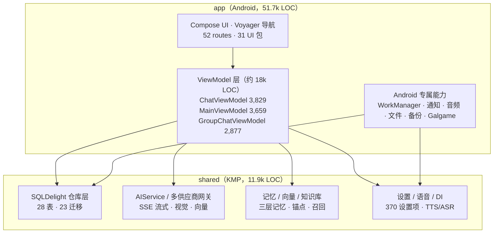
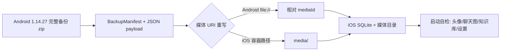

# 罗德岛通讯端 iOS 版可行性分析报告

> 分析对象：`RhodesLink/`（Android 1.14.27 / versionCode 74）
> 分析时间：2026-11-22
> 目标口径：功能完整平移 + iOS 26「液态玻璃（Liquid Glass）」
> 方法：源码静态盘点（68,398 行 Kotlin）+ iOS 27.2 SDK API 实测 + Apple/JetBrains 官方资料核对

---

## 0. 结论摘要

### 0.1 一句话结论

**技术上没有不可逾越的障碍，属于「有条件可行（Conditional GO）」；真正的风险不在代码，而在三件事：后台自动化的产品语义、App Store 的 18+ AI 伴侣合规、以及 5.2 万行 Android 客户端代码的重写成本。**

### 0.2 可行性评级

| 维度 | 评级 | 依据 |
|---|---|---|
| 业务/数据核心移植 | **高（9/10）** | `shared` 的 10,969 行 commonMain **零** `android.*` / `java.*` 依赖；只有 964 行 Android 平台代码（6 个 actual + 1 个兼容层）；Ktor、SQLDelight、Settings、Koin 都已有 iOS 实现 |
| UI 重写 | **中高（7/10）** | 51,678 行 Android 客户端代码（绝大多数是 Compose）、52 条路由、31 个 UI 包；聊天时间线是难点，但不是不可做 |
| 平台能力等价 | **中（6/10）** | 相机/相册/音频/文件/通知都有标准替代；**WorkManager 式后台定时是唯一无法等价保证的能力** |
| 液态玻璃 | **高（9/10，原生路线）** | iOS 26+ 的 `glassEffect` / `GlassEffectContainer` / `UIGlassEffect` 已在 iOS 27.2 SDK 通过编译验证 |
| 同上，Compose 复用路线 | **中（6/10）** | 只有原生 TabView/NavigationStack 的 chrome 是真玻璃；Compose 内容卡片只能模拟 |
| 商店与合规 | **中低（5/10）** | 2026-11-16 起 AI 恋爱/伴侣类自动 18+；当前代码无年龄门、举报、屏蔽；国内上架还涉及备案/生成式 AI 合规 |
| **综合** | **有条件可行** | 技术可做，但需要产品妥协与额外合规功能；预算/周期要按「重写一个客户端」而不是「改一个构建目标」来算 |

### 0.3 推荐路线（先给结论）

| 你的约束 | 推荐 | 周期（全职） | 玻璃真实度 |
|---|---|---|---|
| 玻璃是硬指标 + 有 3-4 人团队 | **KMP 核心 + SwiftUI 原生壳**（路线 A） | 7-9 个月 | ~95%（系统级） |
| 单人 / 想尽快上线 / 可接受玻璃只覆盖系统 chrome | **Compose Multiplatform 复用 UI + 原生导航壳**（路线 B） | 11-14 个月单人，2 人 6-7 个月 | 60-75% |
| 想 3 个月内出「能看」的 iOS 版 | 不建议全量；先做 MVP（私聊 + 记忆 + 设置 + 玻璃壳） | 3-4 个月 | 70% |

> 如果「全部功能 + 液态玻璃」两个条件都不能打折，**路线 A 是唯一能同时满足的选择**；路线 B 会在「内容卡片/输入框/弹窗也是真玻璃」这一点上系统性不达标。

### 0.4 五个必须提前接受的事实

1. **后台主动消息无法按 Android 的语义保证准时**。iOS 没有 WorkManager 的周期任务；`BGAppRefreshTask` 由系统调度、通常只有约 30 秒，`BGProcessingTask` 通常在设备空闲/充电时运行。可行方案是「前台补算 + 后台尽力而为 + 本地通知预排」，这是产品语义变更。
2. **没有服务器就没有真正的后台推送**。App 本身不内置模型、也不带后端；纯本地方案无法在 App 被杀后完成一次耗时的模型生成。要「准点送达」只能加轻后端或改为打开时补算。
3. **Android 数据不能直接给 iOS 用**。跨端迁移只能走现有的完整备份包（zip）；好消息是备份格式已经是平台无关的 JSON + 媒体清单，坏消息是媒体 URI 需要再加一层 iOS 路径重写。
4. **液态玻璃不是「高斯模糊 + 半透明」**。它包含折射、镜面高光、边缘透镜和环境取色，只有系统 API 能做对；Compose 侧的第三方库只能做到「像」，做不到「是」。
5. **18+ 与内容合规是上架门槛，不是可选项**。项目提示词明确支持「成人关系/亲密接触」，Apple 从 2026-11-16 起对 AI 浪漫/性内容自动 18+，且 1.1.4 对露骨色情内容仍可拒审；国内应用商店还涉及 App 备案与生成式 AI 相关合规。

---

## 1. 项目现状盘点

### 1.1 规模

| 指标 | 数值 |
|---|---|
| Kotlin 总行数 | **68,398** |
| `app/src/main`（Android UI + 业务编排） | **51,678 行 / 175 文件** |
| `shared/src`（KMP 核心） | **11,933 行 / 97 文件** |
| 单元测试 / 仪器测试 | 4,787 行 / 43 文件；**324 个 @Test + 10 个仪器测试** |
| 数据库表 | **28 张**（SQLDelight） |
| 数据库迁移 | **23 个 `.sqm`** |
| 导航路由 | **52 条** + 4 个底部 Tab |
| UI 包 | **31 个** |
| 设置项访问器 | 约 **370 个**（`SettingsRepository`） |
| 中文硬编码字面量 | **7,370 条 / 约 19.6 万字** |
| Dialog 调用点 | **163 处**（其中 `AlertDialog` 115 处） |
| Material 图标种类 | **76 种**（220 处引用） |
| 模型供应商 | 11 个聊天配置；4 个 TTS；2 个 ASR；3 个视觉 |
| 现有外观皮肤 | 5 套，其中已有 **FrostedGlass** 磨砂玻璃皮肤 |

### 1.2 现有架构



**关键判断：现有模块边界对 iOS 不友好，但底子很好。**

- `shared` 是真正的 KMP 形状：commonMain 没有 Android/Java import，平台差异集中在 7 个 androidMain 文件（6 个 actual + 1 个 Android 兼容层；数据库驱动、设置、HTTP 引擎、Toast/剪贴板/分享等）。
- 但**最难移植的业务逻辑不在 shared**：提示词拼装、记忆提取与注入、私聊/群聊的轮次状态机、超时与重试、备份导入导出，都在 `app/viewmodel`（含 `viewmodel/shared`）和 `app/data/backup` 里，约 1.8 万行，且继承 `AndroidViewModel`、直接调用 Android 通知与 WorkManager。
- 因此，**第一优先级不是写 iOS 界面，而是把这层「编排逻辑」抽到 shared**。否则 iOS 要么用 Swift 重写一遍（提示词行为必然漂移），要么把整套 ViewModel 塞进 CMP。

### 1.3 平台耦合面

| 层 | 现状 | iOS 影响 |
|---|---|---|
| `shared` commonMain | 0 处 `android.*` / `java.*` | 直接复用 |
| `shared` androidMain | 7 个文件：Platform、DatabaseDriverFactory、DatabaseWrapper、DatabaseCompatibility、SettingsFactory、HttpClient、PlatformUtils | 需要对应 iosMain actual；其中 `DatabaseCompatibility` 是 Android 专有的「修复/兜底」逻辑，iOS 应重写而不是照搬 |
| `app` 主代码 | 59 个文件 import `android.*` | 约占 app 文件的 1/3；大多是 UI、音频、通知、备份、权限，属于预期内的平台层 |
| 数据层 | SQLDelight + SQLite，无 FTS、无 SQLCipher | SQLite 文件本身跨平台；`native-driver` 可直接用 |
| 设置层 | `EncryptedSharedPreferences` 整文件加密，注释里记录了 2,115 秒卡顿的线上事故 | **不要照搬**；iOS 应改为「Keychain 存密钥 + 内存 JSON 配置 + 原子写文件」 |
| 媒体/头像 | 内置头像存编号 `1..147`（→ Android drawable `avatar_N`）；用户图片存 `file://` 绝对路径 | iOS 需打包同名头像资源并按编号解析；用户图片必须改成相对 ID（`media/<uuid>.jpg`） |

### 1.4 现有 iOS 基础

- **没有 iOS target**：`shared/build.gradle.kts` 只有 `androidTarget()`。
- **但依赖已经为 iOS 铺好路**：version catalog 里已有 `ktor-client-darwin`、`sqldelight-native`、`multiplatform-settings`，说明作者原本就考虑过跨平台。
- **工具链偏旧**：Kotlin 2.1.0（2024 年底）、Compose Multiplatform 1.7.1、Gradle 8.10.2、AGP 8.7.1；本机是 Xcode 27.2 / iOS 27.2 SDK。Kotlin/Native 对 Xcode 版本有硬性要求（[Kotlin/Native 文档](https://github.com/JetBrains/kotlin/tree/v2.3.21-RC2/kotlin-native) 明确要求 macOS 上的 Xcode 26+），**升级 Kotlin 是 Phase 0 的第一件事**，且要同时回归 Android 构建。
- **现有测试是资产**：324 个 JVM 测试覆盖提示词形状、记忆、备份容器、TTS、聊天交互策略等；抽出 shared 后可迁移到 `commonTest`，iOS 与 Android 共用同一套行为契约。

> **验证边界**：本报告未执行 Android/Gradle 构建（本机无 Android SDK、JDK 21、Kotlin/Native），也未运行 iOS 模拟器（本机未安装 runtime）。「可编译/可复用」的结论来自源码静态分析 + iOS SDK 的玻璃 API 编译验证；实际工具链打通以 §7.4 的 Phase 0 Spike 为准。

---

## 2. 功能清单与移植映射

> 复用度：★=几乎重写，★★=部分复用，★★★=直接复用。
> 难度：S/M/L/XL。

### 2.0 功能覆盖结论

| 类别 | 功能 | iOS 结论 |
|---|---|---|
| **可 1:1 平移** | 私聊/群聊、三层记忆、向量检索、知识库、动态、日记、报纸、排行、印象、派遣、礼物、麻将/扑克、Galgame、TTS/ASR/通话、备份、设置、客服 | 均可实现；差异主要是 UI 重写与平台适配，工作量见 §8 |
| **可近似平移** | 通知（渠道→通知中心）、分享、剪贴板、Toast、文件选择、图片裁剪、权限 | 交互不同，能力等价 |
| **需产品妥协** | 后台主动消息、群聊自动互动、定时回复 | 改为「前台补算 + 本地通知预排 + 尽力后台」；不能保证准点 |
| **需新增合规功能** | 年龄门、举报、屏蔽、内容分级、隐私清单 | 当前 Android 没有；iOS 上架前必须补，约 2-4 周 |
| **不建议/不可** | 应用最小化、通知渠道、后台常驻、应用双开 | iOS 无对应 API 或平台不允许 |

> 结论：**没有「技术上做不了」的功能，只有「产品语义必须改」的功能**。这也是本报告把后台自动化与 18+ 合规放在最高风险的原因。

### 2.1 核心聊天（私聊 / 群聊）

| 功能 | Android 实现 | iOS 方案 | 复用度 | 难度 |
|---|---|---|---|---|
| 私聊会话、分页、流式回复 | Compose `LazyColumn` + `ChatViewModel` 3,829 行 + SSE | SwiftUI + 倒置 UICollectionView 时间线；shared 轮次引擎 | ★★ | XL |
| 三种互动模式（线上/线下/导演） | 提示词模板 + 状态机 | 复用 shared 模板与状态机 | ★★★ | M |
| 图片消息、头像、聊天背景 | `PickVisualMedia` + `BitmapFactory` + 文件复制 | PhotosPicker / UIImagePicker + 相对媒体 ID | ★★ | M |
| 语音输入（边说边识别） | `AudioRecord` PCM 16k + ASR WebSocket | AVAudioEngine + AVAudioConverter + URLSessionWebSocketTask | ★★ | L |
| 消息 TTS 朗读 | `MediaPlayer` + 分段合成 | AVAudioPlayer / AVAudioEngine + 分段 | ★★ | M |
| 消息操作（引用、撤回、重试、编辑） | Compose 手写交互 + DB | SwiftUI 手写交互 + shared 仓库 | ★★ | L |
| 剧情存档 / 聊天历史 / 重新开始 | `ChatArchive` + 归档上下文 | shared 模型 + SwiftUI 列表 | ★★★ | M |
| 群聊、成员权限、心情、自动聊天 | `GroupChatViewModel` 2,877 行 + 标签解析 | shared 群聊引擎 + SwiftUI | ★★ | XL |
| 群聊自动互动 | WorkManager + 模型调用 | 见 §5.1，尽力而为 | ★ | L |

**风险点**：聊天时间线是 iOS 端最容易翻车的地方——变高气泡、流式插入、键盘避让、图片、引用、撤回、滚动定位叠加在一起。**不要用 `LazyVStack` 硬扛上千条消息**；建议 `UICollectionView`（倒置布局、diffable data source）或经过压测的 SwiftUI 方案，并在 Phase 0 用 2,000 条真实会话做 60/120fps 验证。

### 2.2 角色、关系与资料

| 功能 | Android 实现 | iOS 方案 | 复用度 | 难度 |
|---|---|---|---|---|
| 角色创建/编辑、人设、群聊人设 | `OperatorEditScreen` 1,157 行 + Compose 表单 | SwiftUI Form + 玻璃卡片 | ★★ | L |
| 角色卡导出/导入（zip） | `OperatorPackageWriter/Service` | shared 端口 + `.fileExporter/.fileImporter` | ★★★ | M |
| 头像裁剪、相册、相机 | 内置 147 张头像按编号 + 自绘裁剪 Dialog + `TakePicture` | 打包同名头像 assets；PhotosPicker/UIImagePicker + 自绘裁剪 | ★★ | M |
| 20+ 关系类型、关系网 | Compose 关系图/列表 + DB | SwiftUI Canvas/列表 | ★★ | M |
| 联系人、搜索、排序 | Compose 列表 | SwiftUI 列表 + `.searchable` | ★★ | S |
| 用户身份、印象、等级 | Settings + 生成逻辑 | 复用 shared + SwiftUI | ★★★ | S |

### 2.3 记忆与知识库

| 功能 | Android 实现 | iOS 方案 | 复用度 | 难度 |
|---|---|---|---|---|
| 三层记忆、L1/L2/L3、锚点 | shared 模型/仓库 + 提取流水线（app 侧） | 流水线抽到 shared；iOS 只做展示 | ★★★ | M |
| 向量嵌入（本地哈希 / OpenAI 兼容 / 阿里云） | shared gateway + `vector_memories` 表 | 直接复用（Ktor Darwin） | ★★★ | S |
| 向量召回与签名隔离 | shared `MemoryVectorService` | 直接复用 | ★★★ | S |
| 记忆管理、隐私、会话隔离 | Compose 设置页 + shared 策略 | SwiftUI + shared | ★★★ | S |
| 知识库导入、切块、索引、召回 | shared 4 个 service + 设置页 | 直接复用；文件选择用 `.fileImporter` | ★★★ | M |
| 记忆生成/维护后台任务 | WorkManager `ContextMaintenanceWorker` | BGTask + 前台补算 | ★ | M |

**这是全项目复用度最高的部分**：约 3,000 行核心逻辑可以直接跑在 iOS，只要把 app 侧的 `MemoryV2Pipeline`、`UnifiedMemoryContext`、`PromptTemplates` 从 `AndroidViewModel` 里剥出来。

补充：向量不是 `sqlite-vec`，而是 `embeddingJson` 文本字段 + 应用层余弦相似度（`LocalVectorStoreGateway`），因此 iOS 不需要安装 SQLite 扩展，直接复用。代价是每次召回都要 JSON 解码 + 全候选排序；iOS 首版应压测 1 万条记忆的召回耗时，必要时加缓存或改二进制存储。

### 2.4 内容生态

| 功能 | Android 实现 | iOS 方案 | 复用度 | 难度 |
|---|---|---|---|---|
| 动态广场（发布/点赞/评论） | Compose + DB + 定时生成 | SwiftUI + shared | ★★ | L |
| 干员日记 | 生成任务 + Compose | shared 生成 + SwiftUI | ★★ | M |
| 泰拉见闻报（购报、钱包、30 天保留） | `NewspaperService` + 本地文件 + 2 龙门币 | shared 服务 + SwiftUI；文件仍本地 | ★★ | L |
| 聊天排行榜 / 消费统计 | Compose 列表 + 聚合查询 | SwiftUI + shared 查询 | ★★★ | S |
| 大家的印象 | DB + 生成 | 直接复用模型 | ★★★ | S |
| 礼物/道具 | 图片 + 记录 + 批量赠送 | SwiftUI + shared | ★★ | M |
| 派遣任务（剧情链 + 收益） | Compose + DB + 定时推进 | shared + SwiftUI + 通知 | ★★ | L |
| 自动化每日内容 | WorkManager 4 个 Worker | 见 §5.1 | ★ | L |

### 2.5 玩法

| 功能 | Android 实现 | iOS 方案 | 复用度 | 难度 |
|---|---|---|---|---|
| 麻将（完整规则 + AI + 结算） | Kotlin 引擎 1,072 行 + Compose 1,148 行 + Canvas 牌面 | 引擎抽 shared；牌面用 SwiftUI Canvas/Core Graphics | ★★★ 引擎 / ★ 界面 | L |
| 斗地主 / 跑得快 | `GameRoomScreen` + 规则逻辑 | 同上 | ★★★/★ | L |
| Galgame（视觉小说引擎） | 2,357 行 Compose + 自有存档 + RDG 包 + H5 导出 | SwiftUI 重写，或 WKWebView 跑现有 H5 导出 | ★★（H5 路线更高） | XL |
| 陪睡模式 | 背景音频 + 定时 + TTS | AVAudioSession background + 定时器 | ★★ | M |
| 语音通话（ASR→LLM→TTS 循环） | `LocalAudioController` + `VoiceCallScreen` | AVAudioEngine + 共享网关 | ★★ | L |

**Galgame 的取巧点**：项目已经有「导出 H5 游玩版」的能力。若 iOS 首版不想重写 2.3k 行引擎，可用 `WKWebView` 加载导出的 H5，作为过渡；但编辑器（创建/导入/导出/立绘/分支）仍需原生或第二期补齐。

### 2.6 语音

| 能力 | Android | iOS | 备注 |
|---|---|---|---|
| 录音 | `AudioRecord` 16k PCM | AVAudioEngine + AVAudioConverter | 采样率/声道要严格对齐现有 ASR 协议 |
| ASR | WebSocket（DashScope / 小米） | `URLSessionWebSocketTask` | 现有 `AliyunDashScopeAsrGateway` 是纯 Kotlin，可直接用 |
| TTS | 4 家（MiniMax / Vocu / 火山 / 小米） | 直接复用，音频字节落盘播放 | 需要 `AVAudioSession` 分类与中断处理 |
| 通话 | 前台 Compose 页面 | SwiftUI + 音频会话 | 后台通话不属于 VoIP，别声明 VoIP |
| 耳机/蓝牙/中断 | AudioFocus | AVAudioSession 通知 | 需要真机矩阵测试 |

### 2.7 数据、备份与迁移

| 功能 | Android | iOS | 复用度 | 难度 |
|---|---|---|---|---|
| 完整备份（分类、分页、媒体、zip） | 18 个文件、2,010 行 + `java.util.zip` | 抽 shared + ZIPFoundation/Compression | ★★ | L |
| 恢复（含 Android 路径重写） | `BackupRestorePayloadRewriter` | 同一套逻辑 + iOS 路径适配 | ★★★ | M |
| 角色卡导入/导出 | zip + 头像 | shared + `.fileExporter` | ★★★ | S |
| 聊天记录导出（可读文本） | `ReadableChatExporter` | shared | ★★★ | S |
| 数据清理/统计 | 仓库 + Compose | shared + SwiftUI | ★★★ | S |
| 旧库兼容修复 | Android SQLite 专有逻辑 | iOS 新装无需；恢复包要兼容 | ★ | M |

**跨端迁移的关键验收**：拿一份 1.14.27 的 Android 完整备份，在 iOS 上恢复后，角色、会话、消息、记忆、知识库、动态、媒体、设置（不含密钥）全部可用。现有备份已经带 `mediaId` 与 `originalUri`，是很好的基础；但**绝对路径必须改成相对 ID**，否则 iOS 沙盒路径会让头像/图片全部失效。

### 2.8 设置、调试与客服

| 功能 | Android | iOS | 复用度 | 难度 |
|---|---|---|---|---|
| 模型设置（11 个供应商配置，含自定义端点） | Compose 表单 + Settings | SwiftUI + shared `ProviderConfigs` | ★★★ | M |
| 聊天表现/提示词编辑器 | 1,291 行模板 + 954 行编辑器 | shared 模板 + SwiftUI 编辑器 | ★★★ | M |
| 外观（5 套皮肤，含 FrostedGlass） | Compose Theme | 重做玻璃设计系统 | ★ | L |
| 权限管理 | Compose + 权限检查 | SwiftUI + 系统授权 | ★★ | S |
| 调试日志 | 自建 `DebugLogger` + 文件 | OSLog + 文件导出 | ★★ | S |
| 客服求助（AI） | 知识库 + 提示词 + Compose | shared + SwiftUI | ★★★ | M |
| 开屏动画/音效 | Compose 动画 + `MediaPlayer` | SwiftUI 动画 + AVAudioPlayer | ★ | M |

**总计：52 条路由**，可按上面的 8 组拆成 5 个交付波次，避免一次性重写。

> 本地化：当前 7,370 条中文文案硬编码在 Kotlin 里。首版若只做中文，可以原样搬运；但建议同时建立 iOS String Catalog 或在 shared 建文案 key，否则未来做多语言时要重扫 5 万行 UI 代码。

---

## 3. 技术路线对比

### 3.1 三条路线

#### 路线 A：KMP 核心 + SwiftUI 原生壳（推荐，玻璃优先）

```text
RhodesLink/
├── shared/          # KMP：模型、DB、网络、记忆、向量、知识库、语音网关、领域编排
├── iosApp/          # SwiftUI：TabView / NavigationStack / Glass 设计系统 / 各功能页
└── app/             # 现有 Android，继续复用 shared
```

- iOS 侧只做 UI 和平台适配，业务行为与 Android 共用 Kotlin。
- 玻璃全部用系统 API（`glassEffect`、`GlassEffectContainer`、`.buttonStyle(.glass)`）。
- 代价：需要把 51.7k 行 app 主代码（UI + ViewModel）用 SwiftUI 重写；需要把约 1.8 万行编排逻辑抽到 shared。

#### 路线 B：Compose Multiplatform 复用 UI + 原生导航壳

```text
shared/
├── commonMain/      # 现有 shared + 从 app 迁入的 Compose UI
├── androidMain/     # Android actual
└── iosMain/         # iOS actual + ComposeUIViewController

iosApp/
└── ContentView.swift # TabView + NavigationStack（系统玻璃）+ Compose 页面
```

- 复用最多：大部分 Composable 可迁到 commonMain，Android/iOS 一套 UI。
- 玻璃：官方推荐做法是「SwiftUI 原生 TabView/NavigationStack 负责 chrome，Compose 只渲染页面内容」，系统会自动给 tab/nav 上玻璃；但页面内的卡片、输入框、弹窗**不会**自动玻璃化，需要用 Haze / glassy-liquid-effect 等模拟，或叠 `UIVisualEffectView`（互操作限制多）。
- 代价：Compose iOS 的文本输入/IME、滚动惯性、无障碍、Dynamic Type、iPad 适配都要逐项打磨；长期仍要维护一套跨平台 UI。

#### 路线 C：全原生 Swift 重写（含业务逻辑）

- 不推荐。等于把 68k 行逻辑重写一遍，提示词行为、记忆策略、超时/重试细节必然与 Android 漂移；后续双端维护成本最高。

### 3.2 对比表

| 维度 | A：KMP + SwiftUI | B：CMP + 原生壳 | C：全原生 |
|---|---|---|---|
| 功能完整度 | 高（业务共享） | 高（UI 共享） | 中（行为易漂移） |
| 液态玻璃真实度 | **~95%** | 60-75% | ~95% |
| 首版周期（2-3 人） | 7-9 个月 | 5-6 个月 | 8-10 个月 |
| 单人周期 | 18-24 个月 | 11-14 个月 | 20-26 个月 |
| 代码复用 | 业务 ~12k 行 + 编排 ~18k 行 | UI ~40k 行 + 业务 | 几乎为零 |
| iOS 体验（输入/滚动/无障碍） | 最好 | 中等 | 最好 |
| 长期维护 | 中（两套 UI） | **低（一套 UI）** | 高（两套逻辑） |
| 主要风险 | UI 工作量大 | 玻璃不真、CMP iOS 边角 | 行为漂移、成本最高 |

### 3.3 选择建议

- **如果「液态玻璃」是产品卖点、且你能投入 3-4 人 7-9 个月**：选 A。玻璃是系统能力，只有原生能完整拿到；同时用 KMP 保证提示词/记忆行为与 Android 一致。
- **如果你是单人开发、目标是尽快让 iOS 用户用上**：选 B。先用原生壳拿到 tab/nav 的真玻璃，内容卡片用高质量的「玻璃拟态」过渡；等用户量起来再逐屏原生替换（但要接受两套 UI 的过渡期）。
- **如果只是想验证市场**：先做 MVP（私聊 + 角色 + 记忆 + 设置 + 玻璃壳），3-4 个月，再决定是否补 Galgame/麻将/报纸/自动化。

---

## 4. 液态玻璃落地方案

### 4.1 API 事实（已在本机 iOS 27.2 SDK 验证）

| API | 用途 | 可用性 |
|---|---|---|
| `.glassEffect(_:in:)` | 给任意 View 加玻璃背景/形状 | iOS 26.0+ |
| `GlassEffectContainer(spacing:)` | 多个玻璃元素合并、互相折射、形态融合 | iOS 26.0+ |
| `.buttonStyle(.glass)` / `.glass(...)` | 系统玻璃按钮，支持 tint/interactive | iOS 26.0+ |
| `.glassEffectID(_:in:)` / `.glassEffectUnion` | 配合 `@Namespace` 做玻璃元素间的变形动画 | iOS 26.0+ |
| `.glassEffectTransition(.matchedGeometry/.materialize)` | 玻璃元素出现/消失的转场 | iOS 26.0+ |
| `UIGlassEffect`（UIKit） | `regular` / `clear` 两种风格，支持 `isInteractive`、`tintColor` | iOS 26.0+ |
| `UIGlassContainerEffect`（UIKit） | 多个 `UIGlassEffect` 合并渲染，`spacing` 控制融合距离 | iOS 26.0+ |

验证记录：用 iOS 27.2 SDK 对 `GlassEffectContainer`、`.glassEffect(.regular.tint(...).interactive(), in:)`、`.buttonStyle(.glass)`、`.glassEffect(.clear, in: .capsule)` 做 `swiftc -typecheck -target arm64-apple-ios26.0`，**编译通过**。本机没有安装 iOS 模拟器 runtime，因此未做真机/模拟器视觉验证。

> 重要：用 iOS 26+ SDK 构建的 App，在 iOS 26+ 上系统控件会自动采用 Liquid Glass 新外观；可用 `UIDesignRequiresCompatibility` 临时退回旧外观，但 Apple 只允许过渡一个版本。**新 App 不建议退回**，直接按玻璃设计。

### 4.2 版本策略

| 方案 | 优点 | 缺点 | 建议 |
|---|---|---|---|
| 最低 iOS 26 | 单一设计、玻璃全覆盖、开发简单 | 放弃 iPhone X/8 及更早设备；iOS 26 装机率仍非 100% | 面向 2027 年新用户可选 |
| 最低 iOS 18 + iOS 26 条件玻璃 | 覆盖大、渐进增强 | 两套材质要维护；老系统观感落差 | **推荐** |
| 最低 iOS 17/16 | 覆盖最大 | 玻璃只能模拟，违背需求 | 不推荐 |

实现方式：`if #available(iOS 26, *) { GlassSurface() } else { MaterialSurface() }`，设计 token 统一（圆角、tint、描边、阴影），老系统用 `.ultraThinMaterial` + 细描边近似。

### 4.3 界面映射：哪些地方用玻璃，哪些绝对不用

| 界面/组件 | 玻璃用法 | 说明 |
|---|---|---|
| 底部 Tab Bar | **系统自动** | `TabView` + `.tabBarMinimizeBehavior(.automatic)`，iOS 26 自动浮动玻璃 |
| 顶部导航栏 | **系统自动** | `NavigationStack` + `.toolbar`；标题、返回按钮由系统玻璃承载 |
| 聊天输入栏 | `GlassEffectContainer` + `.glassEffect(.regular.interactive(), in: .capsule)` | 输入框本身保持透明/高对比文字；玻璃只做背景 |
| 发送/语音/加号按钮 | `.buttonStyle(.glass(.regular.tint(.orange).interactive()))` | 用品牌橙色 tint；不要每个按钮都玻璃，2-3 个足够 |
| 聊天头部（角色名/状态） | 薄玻璃条 + 底部 1px 高光 | 滚动时内容从玻璃下穿过，体现层次 |
| 消息气泡 | **不用玻璃** | 用高对比半透明/不透明色；玻璃上放长文会严重伤可读性 |
| 设置列表卡片 | `.regular` 玻璃 + 12-16pt 圆角 | 卡片之间留 12pt，避免玻璃叠玻璃 |
| 弹窗/确认框 | 系统 Alert 自带玻璃；自定义用 `presentationBackground(.clear)` + 玻璃内容 | 不要自绘"假弹窗" |
| 语音通话 HUD | 玻璃圆形按钮 + 波形 | 背景是角色立绘/环境图，玻璃效果最好 |
| 陪睡模式 | 极暗玻璃 + 低亮度文字 | 夜间可读性优先，玻璃透明度要可调 |
| 开屏 Terminal | 玻璃 HUD + 扫描线/故障动画 | 保留工业风；玻璃只做面板，不做全屏 |
| 麻将/扑克/Galgame | **不用玻璃** | 游戏画面需要高对比与性能；最多在结算层用玻璃卡片 |

**设计原则（建议写进设计规范）**：

1. **三层结构**：环境背景（角色立绘/渐变）→ 内容层（不透明或高对比）→ 玻璃 chrome（导航、输入、浮动操作）。
2. **一屏玻璃元素 ≤ 5 个**，相邻元素放进同一个 `GlassEffectContainer` 合并。
3. **玻璃上不放正文**；玻璃上的文字至少 17pt、对比度 ≥ 4.5:1。
4. **统一 token**：`glassRegular`、`glassClear`、`glassTint`、`glassStroke`、`glassRadius=20/24/28`、`glassShadow`。
5. **必须响应**：降低透明度、增强对比度、减弱动态效果、粗体文字。

### 4.4 背景是玻璃的一半

当前 App 的 5 套皮肤都是**纯色背景**（深黑/浅灰/淡紫）。现有的 `FrostedGlass` 皮肤也只是「半透明色 + 描边」，全项目 **0 处 `.blur()`**，并没有真实背景模糊。液态玻璃在纯色背景上几乎看不出效果，只会像一块灰色半透明矩形。要让玻璃"活"起来，必须新增：

- 角色立绘/场景图 + 高斯模糊 + 暗角；
- 或品牌渐变（深海军蓝 + 暖橙光斑）+ 轻微噪点；
- 滚动时背景缓慢视差（`scrollTransition` / `visualEffect`）；
- 暗色模式下的低亮度环境光。

这属于**新增设计工作量**（约 2-3 周），不是代码能自动解决的。建议把它列为 Phase 2 的独立交付物：`AmbientBackground` + 每个角色的 `sceneBackground`。

### 4.5 代码骨架（SwiftUI）

```swift
import SwiftUI

@available(iOS 26.0, *)
struct GlassInputBar: View {
    @Binding var text: String
    var onSend: () -> Void

    var body: some View {
        GlassEffectContainer(spacing: 10) {
            HStack(spacing: 10) {
                Button { /* 附件 */ } label: {
                    Image(systemName: "plus")
                        .frame(width: 38, height: 38)
                }
                .buttonStyle(.glass)

                TextField("输入消息…", text: $text, axis: .vertical)
                    .lineLimit(1...5)
                    .padding(.horizontal, 16)
                    .padding(.vertical, 10)
                    .background(.clear)
                    .glassEffect(.regular.interactive(), in: .rect(cornerRadius: 22))

                Button(action: onSend) {
                    Image(systemName: "arrow.up")
                        .frame(width: 38, height: 38)
                }
                .buttonStyle(.glass(.regular.tint(.orange).interactive()))
            }
            .padding(.horizontal, 12)
        }
        .padding(.bottom, 8)
    }
}

struct AmbientBackground: View {
    var body: some View {
        ZStack {
            LinearGradient(
                colors: [Color(hex: 0x0B1020), Color(hex: 0x1A2238)],
                startPoint: .top, endPoint: .bottom
            )
            Circle()
                .fill(Color.orange.opacity(0.18))
                .frame(width: 320, height: 320)
                .blur(radius: 90)
                .offset(x: 120, y: -180)
            Image("rhodes_scene")
                .resizable()
                .scaledToFill()
                .blur(radius: 40)
                .opacity(0.35)
        }
        .ignoresSafeArea()
    }
}
```

> 示意代码：`Color(hex:)` 需自行实现或改用资产色；示例把玻璃作为 `TextField` 的背景层，实际项目建议用独立的背景容器包住输入框，避免文字层参与玻璃采样。

注意事项：

- 不要把 `.glassEffect` 直接加在 `TextField` 的文字层上；玻璃应作为背景层，文字用 `.foregroundStyle(.primary)` 保证对比。
- 滚动列表里的每一行都不要加玻璃；玻璃只放在固定 chrome 上。
- 用 `@Namespace` + `.glassEffectID` 做「输入栏展开/收起」「Tab 切换」的融合动画；尊重 `accessibilityReduceMotion`。

### 4.6 如果走路线 B（CMP）的玻璃边界

- **真玻璃**：`TabView`、`NavigationStack`、系统 toolbar、系统 Alert/Sheet——由 iOS 26 自动渲染。
- **假玻璃**：Compose 页面内的卡片、输入栏、HUD——需要用 Haze / `glassy-liquid-effect` / `liquid-glass` 等库做背景模糊 + 高光 + 色调；视觉上"很像"，但没有折射/透镜/环境取色，且在深色背景、动态内容、滚动时容易露馅。
- **互操作限制**：Haze 只能模糊 Compose 自己绘制的内容；如果背景是原生 `UIImageView`/`AVPlayerLayer`，需要把内容改为 Compose 渲染，或放弃该区域的玻璃。官方也明确说 Compose 内容不会自动获得系统玻璃（[JetBrains 指南](https://kotlinlang.org/docs/multiplatform/ios-liquid-glass.html)）。
- **结论**：如果验收标准是"和系统设置/音乐 App 一样的玻璃质感"，路线 B 不达标；如果标准是"有 iOS 26 的玻璃味道"，路线 B 可接受。

---

## 5. 平台能力差距与替代方案

### 5.1 后台自动化：唯一无法等价的能力

| Android | iOS | 差距 |
|---|---|---|
| `WorkManager` 周期任务（24h，可约束网络） | `BGAppRefreshTask`（系统调度、约 30s、不保证） | 不能保证每天执行 |
| `OneTimeWork` + 精确延迟（5 分钟/指定时刻） | `BGProcessingTask`（设备空闲时运行，可要求充电；可几分钟） | 不能保证准点 |
| 前台服务/常驻 | 无 | 不能常驻 |
| 通知渠道 + 富文本 | `UNUserNotificationCenter` + 附件/操作 | 可等价，但需重新实现 |
| 后台生成长文本（模型 180s 超时） | 后台任务通常等不到 180s | 必须改为前台/后台 URLSession/提前生成 |

**可行方案（按推荐顺序）**：

1. **前台补算 + 本地通知预排（无后端，推荐首版）**
   - App 在前台时检查"错过的主动消息/动态/日记"，按当前时间补生成；
   - 对已知的固定时刻（如 08:00 早安）提前在前一晚充电时用 `BGProcessingTask` 生成，失败则用模板/上次内容占位；
   - 本地通知到点提醒"角色给你发了消息"，点开 App 再生成真实内容。
   - 代价：不是真后台生成，但用户体验可接受，且不需要服务器。

2. **后台 URLSession（进阶，无后端）**
   - 用 `URLSessionConfiguration.background` 发一次非流式模型请求；系统在后台完成下载后唤醒 App 解析、落库、发本地通知。
   - 优点：单次请求可跑较久，不占 BGTask 的 30s；缺点：只能非流式、系统仍可延迟、错误处理复杂、每个供应商的流式协议要单独适配。
   - 适合"每天 1-3 条主动消息"，不适合群聊高频自动互动。

3. **轻后端 + APNs（要准点才做）**
   - 服务器保存调度与（加密的）用户密钥，代跑模型，推 APNs。
   - 代价：运维、成本、密钥安全、合规；与"不内置模型、密钥只在本机"的现有产品哲学冲突。
   - 除非要做商业化/大规模，否则不建议首版上。

**产品结论**：iOS 版必须把"后台自动互动"重新定义为"**打开即补算 + 尽力而为的后台生成 + 本地通知提醒**"，并在设置页明确说明"iOS 不保证后台准点"。这不是代码能绕过的，是平台规则。

### 5.2 能力对照表

| 能力 | Android 现状 | iOS 替代 | 难度 | 备注 |
|---|---|---|---|---|
| 数据库 | SQLDelight `android-driver` | `native-driver` | S | 28 表/23 迁移可直接跑；首次打开要测迁移耗时 |
| 设置 | EncryptedSharedPreferences | Keychain（密钥）+ JSON 文件（配置） | M | **不要**整文件加密；现有代码已记录 Keystore 卡顿事故 |
| HTTP/SSE | Ktor OkHttp | Ktor Darwin | S | 流式用 `bodyAsChannel`；超时/取消要回归 |
| 图片加载 | Coil 3 | AsyncImage / Kingfisher | S | 支持 HEIC；注意内存缓存 |
| 图片选择 | `PickVisualMedia` | PhotosPicker | S | 无需相册权限 |
| 拍照 | `TakePicture` + FileProvider | UIImagePickerController | S | 需要 `NSCameraUsageDescription` |
| 文件导入/导出 | SAF + `CreateDocument` | `.fileImporter/.fileExporter` + Security-Scoped URL | M | 备份 zip 要注意安全作用域 |
| 分享 | `Intent.ACTION_SEND` | `ShareLink` / UIActivityViewController | S | 角色卡、聊天记录 |
| 剪贴板 | ClipboardManager | UIPasteboard | S | 读取会弹系统提示 |
| Toast | Toast | 自绘 HUD / 玻璃提示条 | S | 更适合玻璃设计 |
| 通知 | NotificationChannel + PendingIntent | UNUserNotificationCenter + 深链 | M | 附件头像需先下载到本地 |
| 权限 | 运行时权限 | Info.plist + AVFoundation/Photos 授权 | S | 相机/麦克风/通知 |
| 深链 | Intent extra | URL Scheme / Universal Link | M | 通知点击进对应会话 |
| iPad / 横屏 / Dynamic Type | 仅手机布局 | NavigationSplitView 或最大宽度约束；Dynamic Type 全量适配 | M | 若声明支持 iPad，需 iPad 截图与适配；仅 iPhone 则以兼容模式运行 |
| 应用最小化 | `moveTaskToBack` | 无对应（不应做） | - | 移除 |
| 日志/崩溃 | 自建 DebugLogger | OSLog + MetricKit/Crashlytics | S | 设置里保留导出 |
| DI | Koin | Koin core（KMP）或 Swift `AppContainer` | M | 建议 Kotlin 侧暴露 `IosAppGraph` 门面 |
| 导航 | Voyager | NavigationStack + 每个 Tab 独立 path | M | 深链/状态恢复要重做 |
| 动画 | Compose Animation | SwiftUI + Core Animation | M | 开屏/玻璃变形 |

### 5.3 数据与备份迁移



必须做的改造：

1. **媒体 ID 化**：用户图片（`avatarUri`、`bg_*`、消息图片、礼物图、报纸素材）从绝对 `file://` 改为 `media/<uuid>.<ext>`；读取时通过 `MediaStore` 解析到当前平台容器。内置头像保持 `1..147` 的数字编号，iOS 侧打包 147 张同名资源（`avatar_1`…`avatar_147`）即可，不需要迁移 URI。
2. **备份重写器跨平台**：把 `BackupRestorePayloadRewriter` 从 `app` 移到 `shared`，注入 `PathAdapter`（Android/iOS 各自实现 `toPlatformUri` / `toRelativeId`）。现有代码已经能识别 `/data/user/0/<pkg>/files/`，扩展 iOS 的 `Application Support` 路径即可。
3. **恢复后自检**：恢复完成 → 检查角色数、会话数、消息数、媒体可读性、设置可读性；失败要能回滚而不是半残。
4. **不迁移密钥**：备份默认排除 API Key（现有 UI 已区分"非敏感设置"）；iOS 首启要求重新填密钥，或通过 Keychain 手动导入。
5. **备份格式版本**：`BackupManifest.formatVersion` 提升时保持向后兼容；iOS 1.0 要能读 Android 1.14.x 的包。

### 5.4 网络、ATS 与端点

- 用户可配置任意 OpenAI 兼容端点，**很可能出现 `http://192.168.x.x:11434`（Ollama/LM Studio）**。iOS ATS 默认禁止明文 HTTP；需要在 `Info.plist` 配 `NSAppTransportSecurity`，并决定：
  - `NSAllowsArbitraryLoads = true`：最省事，但 App Review 可能问原因，需要在审核备注里解释"用户自建模型服务"。
  - `NSAllowsLocalNetworking = true`：只放行局域网；公网 HTTP 端点仍会被拒。更安全，但用户可能输入公网 HTTP。
  - 建议：`NSAllowsLocalNetworking = true` + 对公网 HTTP 给出明确错误提示，引导用户用 HTTPS；若必须支持公网 HTTP，再开 `NSAllowsArbitraryLoads` 并准备审核说明。
- 局域网访问还会触发 **Local Network 权限**弹窗，需要 `NSLocalNetworkUsageDescription`。
- Ktor Darwin 的 SSE/流式：现有 `AIService.streamChat` 用 `bodyAsChannel` 手写行解析，Darwin 引擎支持；但要重点回归**取消、超时、半包、代理、HTTP/2**。
- 语音 ASR WebSocket：`URLSessionWebSocketTask` 可用；注意后台切换时的断线重连（现有代码已有重连逻辑）。

### 5.5 设置存储重设计（重要）

Android 现状：`EncryptedSharedPreferences` 每次写入都整文件重新加密，代码注释记录了 2,115 秒卡顿事故，并留了"明文回退"开关。这是**已知的技术债**，不应复制到 iOS。

iOS 建议：

```text
Keychain:
  - provider API keys (per provider)
  - TTS/ASR keys
  - 可选: 备份加密口令

Application Support/settings.json:
  - 其余 ~370 个配置项（JSON，原子写，内存缓存）
  - 首次启动加载到内存，写入 debounce 200ms
  - 文件保护: .completeUntilFirstUserAuthentication
```

- `SettingsRepository` 的接口不变（同步 get/set），iOS actual 用内存 + 文件落盘；避免每次读 Keychain。
- 迁移：iOS 新装无历史包袱，直接按新方案；Android 可在后续版本逐步把密钥拆到 Keystore/独立文件，解决卡顿。
- 备份：settings 只导出非敏感项；密钥永不进备份。

### 5.6 Kotlin ↔ Swift 的桥接成本

KMP 默认的 Objective-C 导出有几处不适合直接写 SwiftUI：

- `suspend` 函数导出为 completion handler，需要 Swift 侧再包一层 `async`；
- `Flow` / `StateFlow` **不会**自动变成 `AsyncSequence`，需要 [SKIE](https://skie.touchlab.co/) / KMP-NativeCoroutines，或手写回调门面；
- `sealed class/interface` 在 Swift 侧是普通 class 层级，`switch` 无法穷尽；SKIE 可生成 enum；
- 默认参数会生成多个重载；泛型/函数类型导出受限；
- 可空性、集合类型、`Long`/`Int` 映射需要逐项确认。

建议在 `iosMain` 写一层**窄门面** `IosAppGraph`，只暴露 SwiftUI 真正需要的能力：

```kotlin
// iosMain
class IosAppGraph(...) {
    fun chatEngine(): ChatEngineBridge
    fun sessions(): SessionListBridge
    fun settings(): SettingsBridge
    fun backup(): BackupBridge
}

class ChatEngineBridge {
    fun send(text: String, onDelta: (String) -> Unit, onDone: (ChatResult) -> Unit): Cancellable
    fun cancel()
}
```

- Flow 在门面里转成回调 + `Cancellable`，Swift 再包成 `AsyncStream`；
- 用 `@ObjCName` 控制 Swift 命名；
- 如果团队接受第三方编译器插件，SKIE 可省约 2-4 周，但会增加工具链复杂度与升级约束。

**不要把 Kotlin 数据模型直接铺到 SwiftUI 视图层**：在门面层转成 Swift `struct`，否则 Kotlin 侧字段一改，SwiftUI 全量重编译且容易出现可空性崩溃。

### 5.7 工具链升级

| 项 | 现状 | 目标 | 风险 |
|---|---|---|---|
| Kotlin | 2.1.0 | 2.3.x（官方支持 Xcode 26+；Xcode 27 需 Phase 0 实测） | 中：编译行为、Compose 编译器、KSP 版本联动 |
| Gradle | 8.10.2 | 8.14+/9.x（视 AGP） | 中：Android 构建脚本、CI |
| AGP | 8.7.1 | 8.13+ | 中：`compileSdk 35` 可保留 |
| CMP（仅路线 B） | 1.7.1 | ≥1.10.x（支持 iOS 26 原生导航/玻璃互操作） | 高：UI 行为回归 |
| Xcode | - | 27.x（本机） | 低：新项目 |
| JDK | README 要求 21 | 21（CI） | 本机只有 25，Gradle 8.10.2 不支持 25；需装 JDK 21 或用 Docker |

**Phase 0 必须先做一次"双端构建"**：Android `assembleDebug` + iOS `linkDebugFrameworkIosSimulatorArm64` 同时通过，再动 UI。否则会在错误的工具链假设上写几万行代码。

---

## 6. 商店与合规

### 6.1 年龄分级：这是当前最紧急的外部变化

- Apple 2025-07-24 公告新增 13+/16+/18+ 分级，并要求所有 App 回答新的年龄分级问题（[Apple News](https://developer.apple.com/news/?id=ks775ehf)）。
- 2026-11-16 起，**带恋爱功能或 AI 浪漫伴侣的应用自动 18+**，开发者需在 2027-01-12 前完成更新（[报道](https://in.mashable.com/tech/115743/apple-says-no-more-ai-romance-for-minors-as-it-tightens-app-store-rules)）。
- 本项目 `PromptModuleDefaults` 明确写有"成人关系/亲密接触/成人互动请求"，角色关系含 `LOVER/CRUSH`，还有陪睡模式。**按新规几乎必然 18+**。
- 18+ 不等于自动通过：App Review 1.1.4 仍可因"露骨色情内容"拒审。需要：
  - 年龄门（首次启动确认 18+，或 Apple 的 Declared Age Range API）；
  - 内容强度设置（严格/普通/自由），默认严格；
  - 举报/屏蔽入口（按 1.2 UGC 要求）；
  - 用户协议 + 隐私政策 + 客服联系方式；
  - 审核账号/审核说明（如何配置模型、如何触发功能）。

### 6.2 其他商店事项

| 事项 | 要求 | 工作量 |
|---|---|---|
| 隐私清单 | `PrivacyInfo.xcprivacy`；声明无追踪；说明本地数据与第三方模型请求 | 2-3 天 |
| 加密出口合规 | 仅标准 HTTPS 可声明豁免；`ITSAppUsesNonExemptEncryption=false` | 1 天 |
| ATS 例外 | 自定义 HTTP 端点需要审核说明 | 2 天 |
| 本地网络权限 | `NSLocalNetworkUsageDescription` | 1 天 |
| 后台音频 | 陪睡/通话需要 `UIBackgroundModes: audio`；审核可能问"为什么需要" | 1 天 |
| 通知 | 首次启动请求权限的时机要设计（别一进来就弹） | 1 天 |
| 中国大陆 | App 备案（工信部）、ICP、生成式 AI/深度合成相关合规；18+ 内容在国区基本不可行 | 视发行地区，可能 2-6 周 |
| 内购 | 当前代码中未发现龙门币充值入口（仅游戏/报纸消耗）；若未来售卖，必须走 IAP | 0（现在） |

**建议发行策略**：首版先上海外/港澳台 TestFlight，验证 18+ 与内容边界；国内若要做，需单独评估合规，不要假设"和 Android 一样能发"。

### 6.3 许可证

项目是**自定义非商业许可**：非商业可修改分发（保留署名），商业用途需作者书面授权。如果你是作者本人，没问题；如果是第三方接手，App Store 上架（即使免费）也要先确认许可范围。免费应用一般不构成"盈利"，但 Apple Developer Program 费用、捐赠、广告都可能被解释为商业用途，建议书面确认。

---

## 7. 实施计划

### 7.1 团队假设

- 路线 A：1 名 KMP/Kotlin、2 名 iOS、0.5 名设计、0.5 名 QA、0.5 名产品/发布 ≈ 4.5 人。
- 路线 B：1 名 KMP、1 名 iOS、0.5 设计、0.5 QA ≈ 3 人。

### 7.2 阶段计划（路线 A）

| 阶段 | 周期 | 交付物 | 通过标准（Gate） |
|---|---|---|---|
| **P0 技术验证** | 2-3 周 | Kotlin 2.3 + iOS target 可构建；DB/设置/HTTP actual；玻璃壳 Demo；后台实验；备份恢复 Demo | 5 项 spike 全部通过；否则改路线或砍范围 |
| **P1 核心与领域层** | 5-6 周 | `shared/domain`：私聊/群聊轮次引擎、提示词、记忆流水线、备份服务；`iosMain` actual；测试迁移（优先 commonTest） | Android 回归全绿；iOS 端到端测试跑通一轮完整私聊（含流式、记忆、超时） |
| **P2 iOS 基础设施 + 设计系统** | 4 周 | App 壳、DI、导航、DB、媒体库、通知、深链、日志；Glass tokens/组件/背景/动效 | 设计评审通过；滚动 60fps；降低透明度可用；真机视觉验收 |
| **P3 功能波次 1：聊天核心** | 5-6 周 | 私聊、群聊、角色、联系人、消息操作、图片/语音/TTS | 与 Android 逐项对照；2,000 条消息性能达标 |
| **P3 功能波次 2：记忆/知识库/设置** | 4-5 周 | 记忆管理、知识库、模型设置、提示词编辑器、外观、权限 | 备份恢复后数据一致；提示词输出与 Android 对齐 |
| **P3 功能波次 3：内容生态** | 4-5 周 | 动态、日记、报纸、排行、印象、派遣、礼物 | 主要路径 E2E；空态/错误态完整 |
| **P3 功能波次 4：玩法与语音** | 5-6 周 | 麻将、扑克、Galgame、陪睡、语音通话、开屏 | 游戏性能；音频中断/耳机/后台矩阵 |
| **P4 后台/合规/上架** | 4-6 周 | 后台补算、通知预排、年龄门、举报/屏蔽、隐私清单、TestFlight | 审核通过；崩溃率 <0.5%；18+ 分级完成 |

总计约 **33-40 周**（含缓冲），与 7-9 个月一致。

### 7.3 路线 B 的差异

- 省掉 P3 的大部分 UI 重写，改为「UI 迁 commonMain + Android API 替换 + iOS 平台层 + 原生壳」。
- 新增 CMP iOS 专项：文本输入/IME、滚动、Dynamic Type、无障碍、内存、启动时间。
- 周期约 **26-30 周**（2-3 人）。

### 7.4 建议的 2 周 Spike（现在就能做）

| # | 实验 | 通过标准 |
|---|---|---|
| 1 | Kotlin 2.3 + `iosArm64`/`iosSimulatorArm64`，Xcode 27 直接集成 | 真机跑起共享 framework，Android 构建不回归 |
| 2 | `native-driver` 打开 1.14.27 数据库并跑 23 个迁移 | 冷启动 <1.5s；读写/事务正常 |
| 3 | Ktor Darwin 流式请求真实供应商 | 首 token <2s；取消立即生效；240s 超时不误杀 |
| 4 | SwiftUI 玻璃壳 + 聊天输入栏 + 背景 | iPhone 15/SE 60fps；深色/浅色/降低透明度可读 |
| 5 | Android 备份 → iOS 恢复 | 角色/会话/消息/媒体/设置全部正确 |
| 6 | 后台 `BGProcessingTask` + 后台 URLSession 各跑 24h | 记录成功率/延迟；给出产品可接受的承诺文案 |

如果 1/2/3 任一失败，先解决工具链与数据层，不要进入 UI；如果 5 失败，先修媒体 ID 化；如果 6 成功率过低，直接按"前台补算"设计，不要承诺后台准点。

---

## 8. 工作量与成本估算

### 8.1 路线 A（KMP + SwiftUI，人日）

| 模块 | 人日 |
|---|---:|
| P0 技术验证 | 12 |
| `shared` iOS 化（actual + framework + SKIE/门面） | 15 |
| 领域编排抽取（ViewModel/提示词/记忆/备份） | 45 |
| iOS 基础设施（DB/设置/网络/媒体/通知/DI/日志） | 25 |
| 设计系统 + 玻璃 + 导航 + 背景 | 22 |
| 私聊（含时间线、输入、图片、语音、TTS） | 40 |
| 群聊（成员、权限、心情、自动互动 UI） | 28 |
| 角色/联系人/关系/资料 | 18 |
| 记忆 | 9 |
| 知识库 | 9 |
| 动态/日记/排行/印象 | 16 |
| 派遣/礼物 | 8 |
| 报纸 | 9 |
| Galgame（原生重写） | 22 |
| 麻将/扑克（引擎复用 + 界面重写） | 22 |
| 语音/通话/陪睡 | 16 |
| 设置/模型/提示词/外观/权限 | 24 |
| 备份/迁移/导出 | 14 |
| 后台自动化 | 12 |
| 启动/主题/动画 | 8 |
| QA/性能/合规/上架 | 35 |
| **合计** | **409** |
| **含 20% 缓冲** | **约 490 人日 ≈ 22.6 人月** |

- 3-4 人全职：**7-9 个月**。
- 单人全职：**18-24 个月**。
- 若 Galgame 用 H5 过渡，可省约 14 人日。

### 8.2 路线 B（CMP，人日）

| 模块 | 人日 |
|---|---:|
| P0 技术验证 | 8 |
| iOS target + actual + framework | 30 |
| UI 迁 commonMain（app 主代码，约 51.7k 行，含 UI + ViewModel） | 55 |
| Android API 替换（59 个文件） | 30 |
| 领域编排抽取 | 40 |
| 原生导航壳 + 玻璃 chrome | 22 |
| iOS 平台服务（音频/文件/通知/后台/选择器） | 25 |
| QA/性能/合规/上架 | 28 |
| **合计** | **238** |
| **含 20% 缓冲** | **约 286 人日 ≈ 13.2 人月** |

- 2 人全职：**6-7 个月**。
- 单人全职：**11-14 个月**。

### 8.3 成本（粗略）

| 路线 | 人月 | 按 4-6 万/人月 | 说明 |
|---|---:|---:|---|
| A | 22-27 | **90-160 万** | 含设计/QA；外包可能低 20-30%，但返工风险高 |
| B | 13-16 | **52-96 万** | 同上 |
| 个人开发 | - | 主要是时间成本 + Apple $99/年 + 测试机 | 机会成本更高 |

**容易被低估的隐性成本**：

- 玻璃设计系统与背景美术：2-3 周设计 + 可能的插画外包。
- 真机测试矩阵：iPhone SE/15/17 Pro、iPad、蓝牙耳机、车载、弱网。
- App Review 往返：2-6 周，尤其 18+ 与 ATS 说明。
- Android 持续迭代导致的 parity 追平：每个 Android 版本约 0.5-2 人周。
- 备份兼容的回归测试：每次 schema 变更都要双端跑。

---

## 9. 风险登记表

| # | 风险 | 概率 | 影响 | 缓解 |
|---|---|---|---|---|
| R1 | iOS 后台自动化无法等价，用户预期落差 | 高 | 高 | 首版就按"前台补算 + 本地通知"设计；设置页明确说明；用后台 URLSession 提升成功率 |
| R2 | App Store 18+ / AI 内容拒审 | 高 | 高 | 年龄门、内容分级、举报/屏蔽、审核说明；先海外 TestFlight；必要时做内容过滤 |
| R3 | 聊天时间线性能/键盘/滚动体验不达标 | 中 | 高 | 用 UICollectionView 倒置方案；2,000 条压测；Phase 0 先做时间线原型 |
| R4 | Kotlin/Xcode 工具链升级破坏 Android 构建 | 中 | 中 | 独立分支；先升 Kotlin 再升 CMP；CI 双端构建；保留回滚点 |
| R5 | 玻璃可读性差/性能下降/审美不统一 | 中 | 中 | 设计 token；一屏 ≤5 个玻璃面；正文不用玻璃；降低透明度/增强对比；真机评审 |
| R6 | 备份/媒体路径迁移导致数据丢失 | 中 | 高 | 媒体 ID 化；Android→iOS 黄金样本；恢复后自检 + 回滚 |
| R7 | 设置加密照搬导致卡顿 | 中 | 中 | Keychain 只存密钥；配置 JSON + 内存缓存；不要整文件加密 |
| R8 | 双端行为漂移（提示词/记忆/超时） | 高 | 中 | 编排逻辑放 shared；提示词模板单源；共用可迁移测试；每版 parity checklist |
| R9 | 自定义 HTTP 端点被 ATS 拦截/审核质疑 | 中 | 中 | `NSAllowsLocalNetworking` + 明确错误提示；准备审核说明；优先 HTTPS |
| R10 | 语音/音频会话在后台/耳机/中断下异常 | 中 | 中 | AVAudioSession 分类；真机矩阵；中断恢复；与现有重连逻辑对齐 |
| R11 | 国内上架合规（备案/生成式 AI） | 高 | 高 | 先海外；国内单独立项评估；必要时只做工具型定位 |
| R12 | 单人周期过长导致项目烂尾 | 高 | 高 | 选路线 B 或 MVP；按波次交付；每 4 周可运行版本 |

---

## 10. 建议与下一步

### 10.1 决策树

```text
「液态玻璃」是否是必须由系统渲染的真玻璃？
├── 是 → 有 3-4 人 / 7-9 个月预算？
│        ├── 是 → 路线 A（KMP + SwiftUI）
│        └── 否 → 先做 MVP（私聊+角色+记忆+设置+玻璃壳），其余二期
└── 否（「像」即可）→ 路线 B（CMP + 原生壳），2 人 5-6 个月
```

**MVP（3-4 个月，2 人）建议范围**

- 包含：iOS 玻璃壳、私聊（文本/图片/语音输入/TTS）、角色创建与导入、记忆（生成/召回/管理）、模型与外观设置、备份恢复、本地通知。
- 不包含：群聊自动互动、动态/日记/报纸/派遣/排行、麻将/扑克/Galgame、陪睡/通话、后台主动消息（仅前台补算）。
- 目的：用最小范围验证「玻璃 + 角色陪伴」在 iOS 上的留存，再决定是否补全。估算约 120-150 人日。

### 10.2 推荐执行顺序（无论哪条路线）

1. **先抽领域层，再写 UI**：把 `ChatViewModel`/`GroupChatViewModel`/`MainViewModel` 里的轮次状态机、提示词、记忆、超时/重试、备份，迁到 `shared/domain`。这是唯一能保证 iOS 与 Android 行为一致的做法。
2. **先做备份跨端恢复**：这是用户换机最痛的点，也是 iOS 首发的信任基础。
3. **先做聊天时间线原型**：用 2,000 条真实数据压测，再决定 SwiftUI 还是 UICollectionView。
4. **玻璃从"壳"开始**：Tab/导航/输入栏先上，内容卡片后上；先做背景，再做玻璃。
5. **后台自动化按"尽力而为"设计**，不要承诺 Android 级别的准点。
6. **合规前置**：年龄门、举报/屏蔽、隐私清单、审核说明，不要等提审才做。

### 10.3 不建议做的事

- ❌ 直接用 CMP 把整个 App 搬过去，然后期望系统自动给内容卡片上玻璃。
- ❌ 用 Swift 重写提示词/记忆逻辑（必然漂移）。
- ❌ 照搬 Android 的 EncryptedSharedPreferences 设计。
- ❌ 在纯色背景上堆玻璃（会得到一堆灰色半透明矩形）。
- ❌ 承诺"后台准点发消息"（iOS 做不到）。
- ❌ 忽视 18+ 与内容合规，直接提审。

---

## 附录 A：统计口径

| 项 | 命令/来源 |
|---|---|
| 行数 | `find app shared -name '*.kt' -print0 \| xargs -0 cat \| wc -l` |
| 文件数 | `find ... -name '*.kt' \| wc -l` |
| 数据库表 | `shared/src/commonMain/sqldelight/**/*.sq` 的 `CREATE TABLE` |
| 迁移 | `.sqm` 文件数（1-23） |
| 路由 | `AppScreens.kt` 的 `data class/object` |
| 中文文案 | Kotlin 字符串字面量中包含 CJK 的数量 |
| 测试 | `@Test` 注解计数（unit 324，instrumented 10） |
| 玻璃 API | iOS 27.2 SDK `swiftc -typecheck -target arm64-apple-ios26.0` |

## 附录 B：`shared` 的 iOS actual 清单

| commonMain expect | Android actual | iOS 需要 |
|---|---|---|
| `getPlatformName()` | `Platform.android.kt` | 返回 `"iOS"` |
| `createPlatformSettings()` | `SettingsFactory.android.kt` | `NSUserDefaultsSettings` + Keychain 密钥层 |
| `createPlatformEngine()` | `HttpClient.android.kt` | `Darwin.create()` |
| `DatabaseDriverFactory` | `DatabaseDriverFactory.android.kt` | `NativeSqliteDriver` |
| `DatabaseWrapper` | `DatabaseWrapper.android.kt` | 同上 |
| `showToast/copyToClipboard/getClipboardText/shareText/minimizeApp` | `PlatformUtils.android.kt` | UIKit 实现；`minimizeApp` 在 iOS 不适用，改为 no-op 或移除 |
| （Android 专有）`DatabaseCompatibility` | 旧库修复/兜底 | iOS 新装不需要；恢复包场景单独处理 |

## 附录 C：玻璃组件验收清单

- [ ] Tab Bar 在 iOS 26 上浮动/最小化，滚动时内容从玻璃下穿过
- [ ] 导航栏标题、返回按钮为系统玻璃；长按返回有历史栈
- [ ] 聊天输入栏玻璃不遮挡文字；键盘弹起/收起无跳变
- [ ] 一屏玻璃元素 ≤ 5 个；相邻元素合并无重叠阴影
- [ ] 深色/浅色模式对比度 ≥ 4.5:1；降低透明度模式下可读
- [ ] 60fps（iPhone 15）/ 120fps（ProMotion）滚动无掉帧
- [ ] 玻璃动画 ≤ 300ms；Reduce Motion 下改为淡入
- [ ] 弹窗/Sheet 使用系统玻璃；没有"玻璃叠玻璃"
- [ ] 游戏/长文/表格区域不使用玻璃

## 附录 D：参考资料

- JetBrains：Liquid Glass in a Compose Multiplatform app — <https://kotlinlang.org/docs/multiplatform/ios-liquid-glass.html>
- Apple：Adopting Liquid Glass — <https://developer.apple.com/documentation/TechnologyOverviews/adopting-liquid-glass>
- Apple：Updated age ratings in App Store Connect（2025-07-24）— <https://developer.apple.com/news/?id=ks775ehf>
- 报道：Apple 对 AI 浪漫伴侣自动 18+（2026-11-16 生效）— <https://in.mashable.com/tech/115743/apple-says-no-more-ai-romance-for-minors-as-it-tightens-app-store-rules>
- Kotlin/Native 的 Xcode 要求 — <https://github.com/JetBrains/kotlin/tree/v2.3.21-RC2/kotlin-native>
- Haze 的 UIKit 互操作限制 — <https://github.com/chrisbanes/haze/blob/main/docs/scenarios/uikit-interop.md>
- App Review Guidelines — <https://developer.apple.com/app-store/review/guidelines/>

---

> 本报告基于 2026-11-22 的代码与 SDK 状态；若后续升级 Kotlin/Xcode 或调整产品范围，需重新评估 Phase 0 结论。
